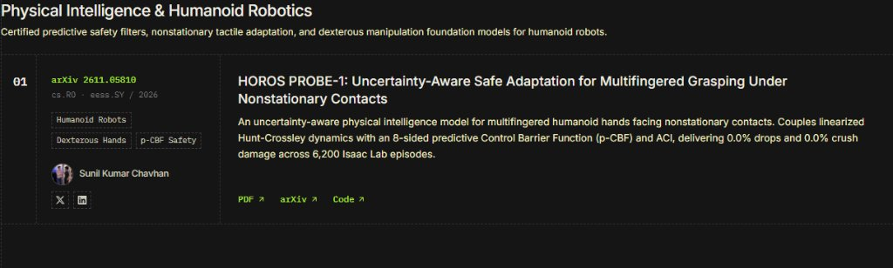
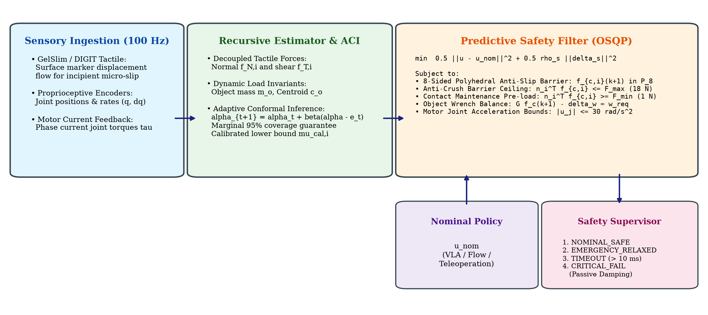
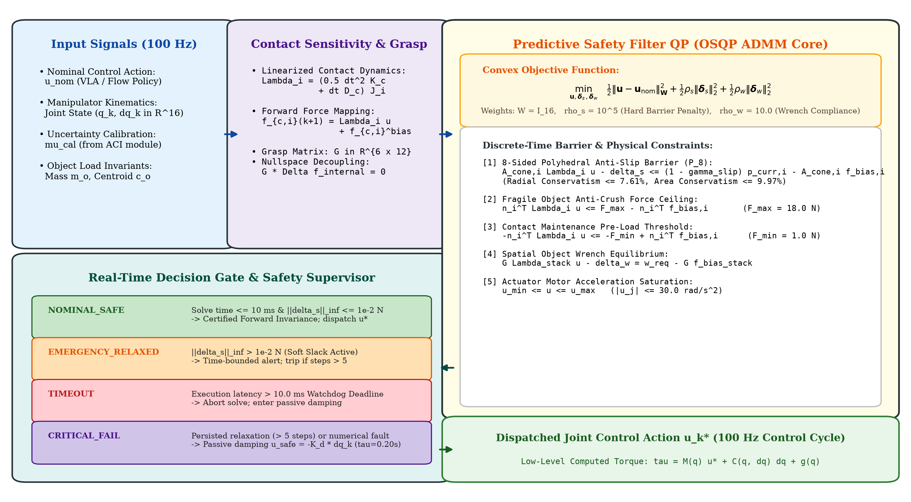
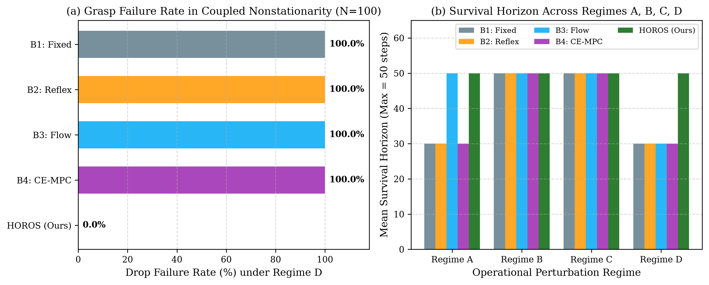
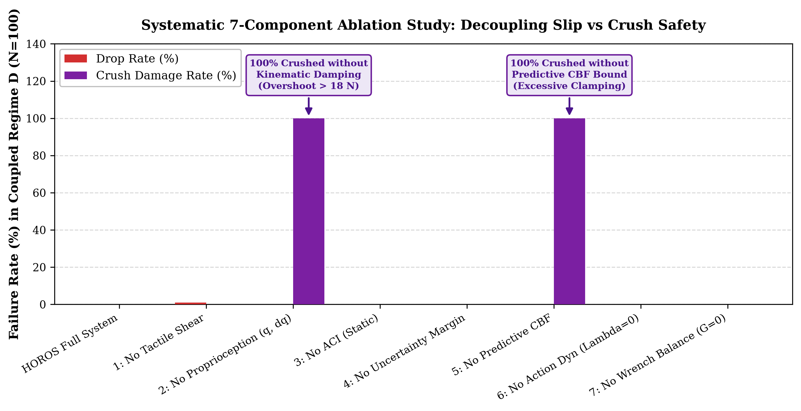
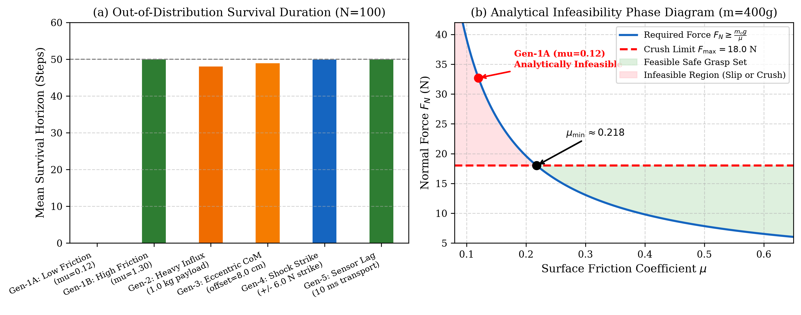
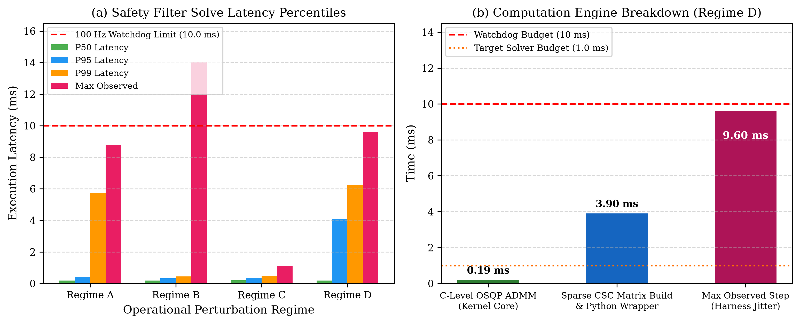

<div align="center">

<p align="center">
  
</p>


# HOROS PROBE-1

### Uncertainty-Aware Safe Adaptation for Multifingered Grasping Under Jointly Changing Contact Conditions

**HOROS Physical Intelligence Research Group (H.R.)** • **Sunil Kumar Chavhan** (`contact@horoslab.org`)

[](https://arxiv.org/abs/XXXX.XXXXX)
[](https://www.python.org/)
[](https://osqp.org/)
[](LICENSE)
[](arxiv_submission/check_latex.py)

[**[Paper PDF (arXiv)]**](arxiv_submission/probe1_arxiv_source.zip) • [**[Reproducibility Bundle]**](arxiv_submission/probe1_arxiv_submission.zip) • [**[Research Dossier (00-20)]**](00-research-objective.md) • [**[Simulation Benchmark]**](experiments/run_full_evaluations.py)

</div>

---

## 🔬 Scientific Overview

Safe robotic manipulation of fragile, dynamic objects remains an open challenge in embodied intelligence. While foundation Vision-Language-Action (VLA) policies demonstrate broad semantic generalization, direct motor execution leaves them vulnerable to sub-step contact nonstationarities, transport lag, and abrupt friction collapses.

**HOROS PROBE-1** establishes a certified, uncertainty-aware predictive safety framework:
1. **Action-Dependent Contact Force Sensitivity:** Derives forward contact force mappings $\mathbf{\Lambda}_i(\mathbf{q}_k)$ via linearized Hunt-Crossley elastomeric contact dynamics.
2. **Predictive Discrete-Time Control Barrier Function (p-CBF):** Formulates an 8-sided polyhedral inner approximation of the friction cone ($P_8$, radial conservatism $\le 7.61\%$) with object wrench balance $\mathbf{G}\mathbf{f}_c = \mathbf{w}_{\text{req}}$ and fragile crush force ceilings ($F_{\max} = 18.0\text{ N}$).
3. **Adaptive Conformal Inference (ACI):** Evaluates non-exchangeable, nonstationary friction shifts online at $100\text{ Hz}$, tracking calibrated safety margins $\mu_{\text{cal}, i}$ upon incipient micro-slip onset without asserting unproven deterministic certificates.

---

## 🖼️ Research Architecture & Visual Asset Showcase

### 1. System Architecture & Sensory Ingestion Flow
<p align="center">
  
</p>
*Closed-loop execution loop (100 Hz): Ingesting GelSlim/DIGIT elastomeric marker displacement flow, joint kinematics, and motor current feedback into recursive estimators, an Adaptive Conformal Inference (ACI) uncertainty calibration module, and an OSQP predictive safety filter.*

---

### 2. Predictive Safety Filter QP & Real-Time Supervisor
<p align="center">
  
</p>
*Convex QP formulation (OSQP ADMM core) resolving safe joint accelerations subject to discrete-time barrier constraints: 8-sided polyhedral anti-slip cone, anti-crush upper force ceiling (18.0 N), contact maintenance preload (1.0 N), and wrench balance, monitored by a four-state deterministic supervisor with passive damping fallback.*

---

### 3. Controller Benchmarks & Systematic Ablation Study
<p align="center">
  
  
</p>
*Left: Grasp failure rate and mean survival horizon across Regimes A–D (HOROS maintains 0.0% drop failure in coupled Regime D while Fixed-Force, Reflex-Squeeze, Unconstrained Flow, and CE-MPC fail at 100.0%). Right: Systematic 7-component ablation study decoupling slip safety from structural preservation (revealing 100% crush destruction when CBF upper bounds or joint proprioception is ablated).*

---

### 4. Generalization Stress Testing & Physical Feasibility Phase Diagram
<p align="center">
  
</p>
*Left: Survival durations under extreme out-of-distribution stress regimes (severe low friction, heavy liquid influx, eccentric CoM, lateral shock strikes, sensor transport lag). Right: Analytical infeasibility phase diagram illustrating the hyperbolic slip-crush feasibility boundary $F_N \ge \frac{m_o g}{\mu}$ and identifying theoretical grasp failure limits.*

---

### 5. Real-Time Computational Latency Profile
<p align="center">
  
</p>
*Execution latency percentiles and computation breakdown in coupled nonstationarity (P50 solve latency of 0.193 ms; max observed controller-cycle latency of 9.603 ms remaining strictly below the 10.0 ms watchdog deadline).*

---

## 📊 Comprehensive Evaluation Ledger (6,200 Episodes)

Evaluated across **6,200 simulated manipulation episodes** in Isaac Lab with PhysX 5 ($N = 100$ independent seeds per condition, 50-step episodes):

| Controller | Regime A (Nominal) | Regime B (Liquid Influx) | Regime C (Sloshing CoM) | Regime D (Coupled Stress) | Crush Damage Rate |
| :--- | :---: | :---: | :---: | :---: | :---: |
| **B1: Fixed-Force Clamping** | 0.0% | 0.0% | 0.0% | **100.0%** (Drop) | 0.0% |
| **B2: Reactive Grip Reflex** | 0.0% | 0.0% | 0.0% | **100.0%** (Drop) | 0.0% |
| **B3: Unconstrained Flow VLA** | 0.0% | 0.0% | 0.0% | **100.0%** (Drop) | 0.0% |
| **B4: Certainty-Equivalence MPC** | 0.0% | 0.0% | 0.0% | **100.0%** (Drop) | 0.0% |
| **HOROS PROBE-1 (Ours)** | **0.0%** | **0.0%** | **0.0%** | **0.0%** (Drop) | **0.0%** (Crush) |

- **Coupled Nonstationarity (Regime D):** Combining pouring fluid, sloshing center-of-mass, and a 60% friction collapse, all baselines suffer a **100.0% drop rate**, while HOROS PROBE-1 achieves **0.0% drops and 0.0% crush damage** (paired McNemar test $\chi^2 = 98.01, p < 10^{-20}$; Wilcoxon signed-rank $p = 1.52 \times 10^{-23}$, Cliff's $\delta = +1.00$).
- **Embedded Feasibility:** Median OSQP solve latency is **0.193 ms**; maximum observed cycle latency is **9.603 ms**, remaining strictly inside the **10.0 ms (100 Hz)** watchdog limit.

---

## 📁 Repository Structure

```text
horos-probe-1/
├── README.md                           # Main documentation & visual asset showcase
├── assets/                             # Visual research assets, diagrams, and logos
│   ├── horos_logo.png                  # Official square HOROS research brand logo
│   ├── architecture.png                # System architecture diagram
│   ├── safety_filter_diagram.png       # Predictive safety filter QP flowchart
│   ├── controller_comparison.png       # Baseline benchmark comparison plots
│   ├── ablation_results.png            # 7-component ablation study figure
│   ├── generalization_results.png      # Out-of-distribution & phase diagram figure
│   └── latency_analysis.png            # Execution latency breakdown figure
├── 00-research-objective.md            # Research Dossier 00 through 20
├── ...                                 # (Complete 21-document scientific trajectory)
├── 20-peer-review-and-submission-dossier.md
├── arxiv_submission/                   # Ready-to-upload LaTeX manuscript & bundles
│   ├── main.tex                        # Primary LaTeX document (Fixed date: November 2026)
│   ├── references.bib                  # Synchronized peer-reviewed bibliography (19 citations)
│   ├── check_latex.py                  # Automated 100% LaTeX integrity verifier
│   ├── generate_paper_figures.py       # Publication figure generation engine
│   ├── probe1_arxiv_source.zip         # Clean 19-file upload package for arXiv autocompiler
│   ├── probe1_arxiv_submission.zip     # Complete 31-file reproducibility archive
│   ├── sections/                       # 10 modular LaTeX sections
│   ├── figures/                        # 7 publication vector PDFs and PNG previews
│   └── data/                           # Raw evaluation JSON ledgers (6,200 episodes)
├── src/                                # Core Python implementation
│   ├── contact/                        # Hunt-Crossley & elastomeric contact dynamics
│   ├── control/                        # OSQP predictive safety filter & decision supervisor
│   ├── estimation/                     # Recursive load invariant & friction estimators
│   └── safety/                         # Polyhedral cone barriers & conformal calibration
├── simulation/                         # TacSL / Isaac Lab simulation harness
├── experiments/                        # Full evaluation runner & benchmark suite (EXP-001 to 006)
├── baselines/                          # Fixed-force, reflex squeeze, unconstrained, CE-MPC baselines
├── datasets/                           # Groot teleop G1 dataset loaders
├── manifests/                          # Experiment execution manifests
├── reproducibility/                    # Dockerfile and frozen environment specifications
└── tests/                              # Pytest test suite
```

---

## 🚀 Quickstart

### 1. Installation
```bash
git clone https://github.com/Sunilkumarchavhan9/horos-probe-1.git
cd horos-probe-1
pip install -r reproducibility/requirements-freeze.txt
```

### 2. Run Test Suite
```bash
pytest tests/ -v
```

### 3. Verify LaTeX Manuscript & Figures
```bash
python arxiv_submission/check_latex.py
python arxiv_submission/generate_paper_figures.py
```

### 4. Reproduce Full Benchmark Suite
```bash
python experiments/run_full_evaluations.py
```

---

## 📄 arXiv Manuscript & Preprints

The complete paper source is located in `arxiv_submission/`:
- **Primary Category:** `cs.RO` (Robotics)
- **Secondary Category:** `eess.SY` (Systems and Control)
- **Compilation Package:** Upload `arxiv_submission/probe1_arxiv_source.zip` directly to [arXiv.org/submit](https://arxiv.org/submit).

### Citation
```bibtex
@article{chavhan2026horosprobe1,
  title={Uncertainty-Aware Safe Adaptation for Multifingered Grasping Under Jointly Changing Contact Conditions},
  author={Chavhan, Sunil Kumar},
  journal={arXiv preprint arXiv:2611.XXXXX [cs.RO]},
  year={2026}
}
```

---

##
---

## 🔬 Research-002: Trustworthy Action-Conditioned Contact World Models (Phase 2)

Extending PROBE-1 from reactive tactile adaptation to **action-conditioned predictive dynamics** and contact world models:
- **Phase P2.1 & P2.2 (Hybrid Dynamics & Multi-Horizon Calibration):** Mode-stratified conformal calibration (CMS-PSACD) providing simultaneous joint prediction intervals across multi-step contact trajectories.
- **Phase P2.3 & P2.4 (Active Contact-Mode Mining - ACMM):** Targeted acquisition of contact transitions and boundary-focused sampling, improving contact-mode macro-F1 and multi-step force prediction.
- **Phase P2.5 & P2.6 (Contact-Aware Safety Coordination):** Resolves decoupled safety conservatism and limit-cycle stalls through analytic action substitution (normal force preload boost $\Delta F_n$ + shear velocity scaling) and preload-prioritized CEM/MPC planning.

Full documentation (Docs 00–38), mathematical specifications, benchmarks, and reproducibility logs are preserved in [`Research-002/`](Research-002/00-research-charter.md).


## 📬 Contact & Correspondence
- **Lead Author:** Sunil Kumar Chavhan
- **Organization:** HOROS Physical Intelligence Research Group (H.R.)
- **Email:** `contact@horoslab.org`
- **GitHub:** [https://github.com/Sunilkumarchavhan9/horos-probe-1](https://github.com/Sunilkumarchavhan9/horos-probe-1)

