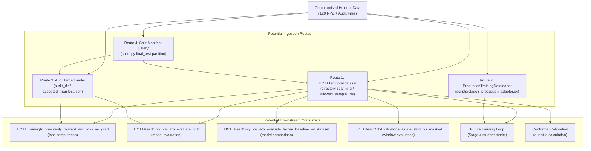

# HOROS PROBE-1 — Research-002
## Stage 3.6 Deliverable 01: Repository Data-Flow & Holdout Exposure Audit

**Program:** HOROS Physical Interaction Data Engine (PIDE)  
**Research Program:** PROBE-1 — Autonomous Robotic Manipulation World Model  
**Stage:** Stage 3.6 — Blind Holdout Quarantine & Evaluation Integrity Recovery  
**Document Identifier:** `HOROS-P1-R002-STAGE36-REP-01-EXPOSURE-AUDIT`  
**Date:** 2026-11-25  
**Governance State:** `TRAINING_PERMITTED = 0` | `EXECUTION_AUTHORIZED = 0` | `NEW_HOLDOUT_GENERATION = NOT_AUTHORIZED` | `FINAL_HOLDOUT_EVALUATION = BLOCKED`  

---

### 1. Executive Summary & Integrity Incident Description

In Stage 3.5, a 120-episode holdout dataset was generated under `experiments/stage35_production/final_holdout/` comprising:
- 60 Compliant Prelift episodes ($T=40$, seeds `3531000..3533011`)
- 60 Peg-in-Hole episodes ($T=30$, seeds `3541000..3545011`)
- Complete trajectory arrays (`120` `.npz` files: states, actions, next_states, wrenches, next_wrenches)
- Audit manifests and privileged metadata (`120` `.privileged.json` files: contact modes, true friction $\mu$, true object mass $m$, initial conditions)
- Manifests linking sample IDs, slot aliases (`prod35_final_holdout_*`), seeds, and SHA-256 digests

During the Stage 3.5 completion synchronization, these files were committed and pushed to the public GitHub repository `Sunilkumarchavhan9/horos-probe-1` (commit `6f0cae6`).

**Scientific Integrity Finding:**  
Even though `final_holdout_evaluated=false` was strictly maintained, no model parameters were trained on these episodes, and the manifest labeled the partition `sealed = true`, **the dataset was exposed to public access**. Because clones, forks, web caches, or automated crawlers may have acquired the trajectory files, seeds, and ground-truth physics labels, this dataset is **permanently compromised as a blind evaluation benchmark**. Removing files or rewriting git history cannot mathematically restore unobserved blindness.

Therefore, this audit systematically maps every reference, ingestion path, split selection, evaluator, checkpoint comparison, and report across the repository to ensure this dataset cannot be consumed in future workflows.

---

### 2. Comprehensive Inventory of Compromised Artifacts

The compromised holdout resides in the following directory tree:
```text
experiments/stage35_production/final_holdout/
├── accepted_manifest.json (120 entries, linking sample_ids to seeds 3531000..3545011)
├── rejected_manifest.json (0 entries)
├── audit/
│   ├── stage35_audit_manifest.json (protocol HOROS-P1-R002-STAGE3.5-FINAL_HOLDOUT)
│   └── syn_*.privileged.json (120 files containing ground-truth modes, mu, mass)
└── training/
    └── *.npz (120 files containing full trajectory arrays: states, actions, next_states, wrenches)
```

#### Compromised Identification Signatures
- **Dataset / Holdout ID:** `stage35_final_holdout`
- **Directory Path Names:** `final_holdout`, `stage35_production/final_holdout`
- **Slot Aliases:** `prod35_final_holdout_compliant_prelift_*`, `prod35_final_holdout_peg_in_hole_*`
- **Audit Manifest Protocol:** `HOROS-P1-R002-STAGE3.5-FINAL_HOLDOUT`
- **Seed Ranges:**
  - `compliant_prelift`: `3531000..3531029` (nominal), `3532000..3532017` (probe), `3533000..3533011` (nonstationary) [60 seeds]
  - `peg_in_hole`: `3541000..3541029` (nominal), `3544000..3544017` (impact), `3545000..3545011` (wedging) [60 seeds]
- **Sample IDs:** Exactly 120 unique 64-hex SHA-256 HMAC strings listed in `final_holdout/accepted_manifest.json` and `stage35_final_split_manifest.json["splits"]["final_test"]["sample_ids"]`.

---

### 3. Systematic Ingestion & Data-Flow Route Mapping

The audit identified five critical routes through which the compromised holdout could accidentally or intentionally be ingested:



#### Route 1: Trajectory Ingestion via `HCTTTemporalDataset` (`dataset.py`)
- **Mechanism:** `HCTTTemporalDataset(training_dir=..., allowed_sample_ids=...)` scans `training_dir` for `*.npz` files.
- **Risk:** If `experiments/stage35_production/final_holdout/training` is supplied, or if a user provides an alias directory containing these 120 `.npz` files, or if `allowed_sample_ids` includes the compromised IDs, the dataset loader parses all trajectory arrays into memory.
- **Quarantine Defense Required:** Reject the holdout in `__init__` before any `.npz` file is opened, checking directory path, filename sample IDs, and `allowed_sample_ids`.

#### Route 2: Production Dataloader Ingestion (`stage3_production_adapter.py`)
- **Mechanism:** `ProductionTrainingDataloader(training_dir)` glob-reads all `.npz` archives.
- **Risk:** Direct training loop ingestion if pointed at the holdout directory.
- **Quarantine Defense Required:** Add fail-closed path and filename validation asserting non-membership in compromised holdout signatures.

#### Route 3: Supervised Target Ingestion via `AuditTargetLoader` (`target_loader.py`)
- **Mechanism:** `AuditTargetLoader(production_root=...)` loads `accepted_manifest.json` and `.privileged.json` targets.
- **Risk:** If pointed at `final_holdout`, it supplies ground-truth contact modes and $(\mu, m)$ to loss and evaluation functions.
- **Quarantine Defense Required:** Tag the loader with `is_compromised = True` and `quarantine_status = "COMPROMISED_PUBLIC_EXPOSURE"`. Forbid `get_batch_targets()` on any compromised sample ID, and forbid evaluator consumption.

#### Route 4: Split Manifest Dereference (`splits.py`)
- **Mechanism:** `stage35_final_split_manifest.json` stores 120 sample IDs under `splits["final_test"]`.
- **Risk:** An evaluation script iterating through manifest splits might select `final_test` assuming it is a valid sealed blind test set.
- **Quarantine Defense Required:** Add `assert_split_eligible_for_evaluation(manifest, split_name)` which immediately raises `CompromisedHoldoutError` if `split_name == "final_test"` or if its entries intersect with compromised holdout seeds/IDs.

#### Route 5: Evaluator Execution (`evaluator.py`)
- **Mechanism:** `HCTTReadOnlyEvaluator` methods (`evaluate_hctt`, `evaluate_frozen_baseline_on_dataset`, `evaluate_strict_vs_masked`, `evaluate_persistence_and_const_vel_baselines`).
- **Risk:** Model evaluation, hyperparameter selection, or checkpoint ranking on compromised data.
- **Quarantine Defense Required:** Enforce `verify_dataset_eligibility` and `verify_holdout_eligibility` at the entry of every evaluation method. Provide an explicit `evaluate_final_holdout()` method requiring certified private holdout credentials.

---

### 4. Manifest & Report References Audit

The following historical reports reference `final_holdout` and `final_test`:
1. `experiments/stage35_production/stage35_dataset_manifest.json`: Lists `final_holdout` under `subdatasets`. Preserved as historical generation record; annotated via Stage 3.6 quarantine record.
2. `experiments/stage35_production/stage35_final_split_manifest.json`: Lists `final_test` with 120 episodes. Preserved as immutable historical record; locked against evaluation.
3. `experiments/stage35_production/stage35_verification_metrics.json`: Records `"final_holdout_evaluated": false`. Confirms zero evaluation occurred prior to quarantine.
4. `experiments/stage35_production/reports/stage35_*.md`: Technical reports documenting generation and theoretical design. Preserved with explicit Stage 3.6 quarantine addenda.
5. `experiments/stage3_production/reports/stage3_research_register_update.md`: Research register. Must be updated to reflect Stage 3.6 status and evaluation block.

---

### 5. Conclusion & Action Plan

The compromised holdout is fully mapped. The vulnerability is entirely confined to **blind evaluation validity**—no models were trained on it, and no parameters were updated.

The remediation proceeds as follows:
- **Phase B:** Issue authoritative quarantine record `holdout_quarantine_record.json`.
- **Phase C:** Implement fail-closed guards in `contracts.py`, `dataset.py`, `target_loader.py`, `evaluator.py`, `splits.py`, `runner.py`, and `stage3_production_adapter.py`.
- **Phase D:** Verify complete preservation of Stage 3.3 datasets, Stage 3.5 `prelift_long` ($T=40$), and frozen checkpoints.
- **Phase E:** Author comprehensive regression suite `test_p45_stage36_holdout_quarantine.py`.
- **Phase F & G:** Update research register and run full regression verification (P40–P45).
