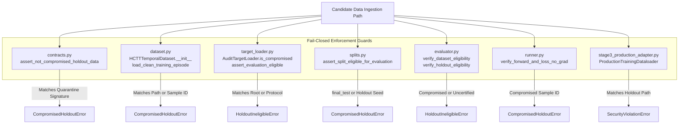

# HOROS PROBE-1 — Research-002
## Stage 3.6 Deliverable 02: Blind Holdout Quarantine & Evaluation Integrity Report

**Program:** HOROS Physical Interaction Data Engine (PIDE)  
**Research Program:** PROBE-1 — Autonomous Robotic Manipulation World Model  
**Stage:** Stage 3.6 — Blind Holdout Quarantine & Evaluation Integrity Recovery  
**Document Identifier:** `HOROS-P1-R002-STAGE36-REP-02-QUARANTINE-REPORT`  
**Date:** 2026-11-25  
**Governance State:** `TRAINING_PERMITTED = 0` | `EXECUTION_AUTHORIZED = 0` | `NEW_HOLDOUT_GENERATION = NOT_AUTHORIZED` | `FINAL_HOLDOUT_EVALUATION = BLOCKED`  

---

### 1. Executive Summary & Incident Attribution

During Stage 3.5, a 120-episode candidate final holdout dataset (`stage35_final_holdout`) was generated under `experiments/stage35_production/final_holdout/`, consisting of:
- **60 Compliant Prelift episodes** ($T=40$, $\Delta t=0.01\text{ s}$, nominal/probe/nonstationary strata).
- **60 Peg-in-Hole episodes** ($T=30$, $\Delta t=0.01\text{ s}$, nominal/impact/wedging strata).
- Complete trajectory arrays (120 `.npz` files: states, actions, next_states, wrenches, next_wrenches).
- Complete privileged ground truth (120 `.privileged.json` files: true friction $\mu$, true object mass $m$, operational contact modes).
- Full manifests linking sample IDs, seeds (`3531000..3545011`), and SHA-256 provenance hashes.

In commit `6f0cae6`, these artifacts were pushed to the public GitHub repository `Sunilkumarchavhan9/horos-probe-1`. 

**Scientific Integrity Impact:**  
Even though:
1. `training_permitted = 0` and `execution_authorized = 0` were strictly maintained (zero training steps executed);
2. `final_holdout_evaluated = false` was verified (zero forward passes or metrics calculated on this holdout);
3. The dataset was designated `sealed = true` in historical manifests;

**public exposure permanently destroys blind evaluation validity**. Trajectory arrays, physical parameter labels, and generation seeds cannot be proven unobserved by automated scrapers, forks, or cached mirrors. Silently renaming, altering manifests, or removing the files from Git history does not restore statistical blindness.

Stage 3.6 formalizes the permanent quarantine of this dataset, implements fail-closed architectural guards across all evaluation pathways, and specifies the prerequisite remediation for future Stage 4 evaluation.

---

### 2. Formal Quarantine Status & Record Ledger

An immutable quarantine record has been registered at:
`Research-002/experiments/stage36_holdout_quarantine/holdout_quarantine_record.json`

```json
{
  "quarantine_id": "HOROS-P1-R002-STAGE36-QREC-01",
  "status": "COMPROMISED_PUBLIC_EXPOSURE",
  "holdout_id": "stage35_final_holdout",
  "protocol": "HOROS-P1-R002-STAGE3.5-FINAL_HOLDOUT",
  "affected_episodes": {
    "total_count": 120,
    "compliant_prelift_count": 60,
    "peg_in_hole_count": 60,
    "seed_ranges": {
      "compliant_prelift_nominal": [3531000, 3531029],
      "compliant_prelift_probe": [3532000, 3532017],
      "compliant_prelift_nonstationary": [3533000, 3533011],
      "peg_in_hole_nominal": [3541000, 3541029],
      "peg_in_hole_impact": [3544000, 3544017],
      "peg_in_hole_wedging": [3545000, 3545011]
    }
  },
  "eligibility_flags": {
    "blind_evaluation_eligible": false,
    "training_eligible": false,
    "validation_eligible": false,
    "calibration_eligible": false,
    "checkpoint_selection_eligible": false,
    "final_evaluation_eligible": false,
    "tuning_eligible": false,
    "model_selection_eligible": false,
    "benchmark_eligible": false,
    "holdout_eligible": false
  }
}
```

The underlying Stage 3.5 artifacts are preserved untouched as immutable historical records. They are not erased or relocated, but are locked against future ingestion by code-level barriers.

---

### 3. Fail-Closed Architectural Safeguards

To prevent any accidental ingestion, evaluation, or benchmarking of the quarantined holdout, fail-closed guards have been integrated into 7 core modules:



#### Detailed Safeguard Specifications:

1. **`src/world_model_vnext/contracts.py`**:
   - Declares `CompromisedHoldoutError` and `HoldoutIneligibleError` (subclassing `ContractViolationError`).
   - Defines authoritative constants: `COMPROMISED_HOLDOUT_ID = "stage35_final_holdout"`, `COMPROMISED_HOLDOUT_STATUS = "COMPROMISED_PUBLIC_EXPOSURE"`, `COMPROMISED_HOLDOUT_PROTOCOL = "HOROS-P1-R002-STAGE3.5-FINAL_HOLDOUT"`.
   - Implements `is_compromised_holdout_seed(seed)`, `is_compromised_holdout_sample_id(sample_id)`, and `is_compromised_holdout_path(path)`.
   - Implements `assert_not_compromised_holdout_data(item, context)`.

2. **`src/world_model_vnext/dataset.py`**:
   - In `_refuse_colocated_audit_files(training_dir)` and `HCTTTemporalDataset.__init__`: inspects supplied directories and immediately raises `CompromisedHoldoutError` prior to scanning files.
   - Rejects `allowed_sample_ids` immediately if any ID belongs to the quarantined holdout.
   - In `load_clean_training_episode`: validates path and loaded `sample_id` against the compromised registry, failing closed even if files are renamed or moved to an alias directory.

3. **`src/world_model_vnext/target_loader.py`**:
   - Detects compromised root or `COMPROMISED_HOLDOUT_PROTOCOL` during `_load_and_verify_root`, setting `self.is_compromised = True` and `self.quarantine_status = "COMPROMISED_PUBLIC_EXPOSURE"`.
   - Implements `assert_evaluation_eligible()`, raising `HoldoutIneligibleError`.
   - In `get_batch_targets`: immediately rejects batch queries if the loader is compromised or if any requested sample ID is quarantined.

4. **`src/world_model_vnext/splits.py`**:
   - Implements `assert_split_eligible_for_evaluation(manifest, split_name)`.
   - Automatically raises `CompromisedHoldoutError` if `split_name in ("final_test", "stage35_final_holdout")` or if any member sample ID or seed intersects the quarantined pool.

5. **`src/world_model_vnext/evaluator.py`**:
   - Implements `verify_dataset_eligibility(dataset, target_loader)`.
   - Implements `verify_holdout_eligibility(holdout_identifier, credentials)`.
   - Implements `evaluate_final_holdout(model, dataset, target_loader, holdout_credentials)`.
   - Enforces dataset and loader eligibility at the entry point of all evaluation methods (`evaluate_hctt`, `evaluate_frozen_baseline_on_dataset`, `evaluate_strict_vs_masked`, `evaluate_persistence_and_const_vel_baselines`).

6. **`src/world_model_vnext/runner.py`**:
   - In `verify_forward_and_loss_no_grad`: validates `model_inputs` and `audit_targets`, raising `CompromisedHoldoutError` if any quarantined sample ID is supplied.

7. **`scripts/stage3_production_adapter.py`**:
   - In `ProductionTrainingDataloader.__init__` and `_load_archive`: rejects quarantined directory paths and archives with `SecurityViolationError`.

---

### 4. Verification & Regression Results

The quarantine implementation and Stage 3.6A guard hardening were verified across the complete 92-test regression suite, including the dedicated Stage 3.6 quarantine suite (`test_p45`) and Stage 3.6A hardening suite (`test_p46`):

#### A. Initial Quarantine Enforcement (`test_p45_stage36_holdout_quarantine.py`, 13 tests)
| Test Case | Description | Result |
| :--- | :--- | :---: |
| `test_old_stage35_holdout_classified_as_compromised` | Verifies metadata, seed ranges, 120 sample IDs, and all eligibility flags = False | **PASSED** |
| `test_final_evaluator_rejects_compromised_holdout` | Evaluator rejects `stage35_final_holdout` and uncertified credentials | **PASSED** |
| `test_rejection_happens_before_trajectory_archive_loading` | Dataset rejects directory without calling `np.load` on trajectory files | **PASSED** |
| `test_training_data_discovery_cannot_select_compromised_holdout` | Training dataloader and episode loader refuse holdout archives | **PASSED** |
| `test_validation_data_discovery_cannot_select_compromised_holdout` | Dataset refuses `allowed_sample_ids` containing quarantined IDs | **PASSED** |
| `test_calibration_cannot_select_compromised_holdout` | Split manifest asserts forbid selecting `final_test` or holdout seeds | **PASSED** |
| `test_checkpoint_selection_cannot_consume_compromised_holdout` | Baseline evaluation and strict-vs-masked reject compromised dataset | **PASSED** |
| `test_alternative_manifest_aliases_cannot_bypass_guard` | Spoofed directory names and renamed archives are rejected via sample ID | **PASSED** |
| `test_no_silent_fallback_to_old_holdout` | Audit target loader marks root compromised and rejects batch target retrieval | **PASSED** |
| `test_train_val_calib_splits_remain_unchanged` | Train (698), Val (126), Calib (126) remain 100% disjoint and intact | **PASSED** |
| `test_training_authorization_remains_disabled` | `TRAINING_PERMITTED = 0`, `EXECUTION_AUTHORIZED = 0`, runner rejects train calls | **PASSED** |
| `test_locked_objective_configuration_remains_unchanged` | 4-term locked weights intact; 3-term objective remains unauthorized | **PASSED** |
| `test_existing_temporal_window_and_dataset_integrity_pass` | Clean `prelift_long` ($T=40$) dataset loads and yields valid strict windows | **PASSED** |

#### B. Stage 3.6A Quarantine Guard Hardening (`test_p46_stage36a_quarantine_hardening.py`, 16 tests)
| Test Case | Penetration Angle & Hardening Guarantee | Result |
| :--- | :--- | :---: |
| `test_original_compromised_directory_rejected` | Direct ingestion of original quarantined folder fails closed | **PASSED** |
| `test_renamed_compromised_archive_rejected_before_np_load` | Content SHA-256 rejects renamed `.npz` before `np.load` is called | **PASSED** |
| `test_relocated_compromised_archive_rejected` | Relocated archive in arbitrary directory fails closed on content digest | **PASSED** |
| `test_original_archive_sha256_detected` | All 120 quarantined `.npz` cryptographic digests verified in quarantine registry | **PASSED** |
| `test_renamed_privileged_json_rejected_before_parsing` | Content SHA-256 rejects renamed `.privileged.json` before JSON parsing | **PASSED** |
| `test_compromised_target_loader_root_rejected_during_construction` | `AuditTargetLoader` constructor raises `HoldoutIneligibleError` immediately | **PASSED** |
| `test_compromised_ground_truth_data_never_loaded` | Privileged ground truth files are never read or deserialized | **PASSED** |
| `test_alternative_split_names_cannot_bypass_quarantine` | Manifests with alternative split names (e.g. `eval_v2`) fail on member IDs | **PASSED** |
| `test_missing_sample_ids_cannot_silently_grant_eligibility` | Positive assertion: missing or empty `sample_ids` immediately rejected | **PASSED** |
| `test_missing_seed_fields_cannot_silently_grant_eligibility` | Positive assertion: missing or empty `seeds` immediately rejected | **PASSED** |
| `test_caller_supplied_boolean_credentials_rejected` | Evaluator rejects caller-supplied boolean flags (e.g. `certified: True`) | **PASSED** |
| `test_all_final_evaluation_routes_reject_old_holdout` | All final evaluation paths fail closed with `NEW_PRIVATE_HOLDOUT = NOT_CREATED` | **PASSED** |
| `test_all_baseline_evaluation_routes_enforce_eligibility` | Baseline evaluators enforce dataset eligibility checks | **PASSED** |
| `test_training_authorization_remains_locked` | Training authorization barrier remains unbroken (`TRAINING_PERMITTED = 0`) | **PASSED** |
| `test_train_val_calib_partitions_remain_unchanged` | Preserved partitions (698 train, 126 val, 126 calib) remain unchanged | **PASSED** |
| `test_locked_objective_remains_unchanged` | 4-term multi-objective configuration remains locked and intact | **PASSED** |

#### C. Stage 3.6B Fail-Closed Security Correction (`test_p47_stage36b_fail_closed_quarantine.py`, 10 tests)
| Test Case | Security Vulnerability & Hardening Guarantee | Result |
| :--- | :--- | :---: |
| `test_quarantine_verifier_import_failure_blocks_loading` | Verifier import failure (`ImportError`) raises `SecurityViolationError` before `np.load` | **PASSED** |
| `test_missing_digest_registry_blocks_loading` | Missing quarantine record raises `SecurityViolationError` before `np.load` | **PASSED** |
| `test_malformed_digest_registry_blocks_loading` | Malformed or incomplete registry (< 120 digests) raises `SecurityViolationError` | **PASSED** |
| `test_verification_function_failure_blocks_loading` | Unexpected verifier exception fails closed (`SecurityViolationError`) before `np.load` | **PASSED** |
| `test_exact_compromised_archive_copied_under_neutral_filename_rejected` | Renamed archive rejected via streaming SHA-256 before `np.load` (`assert_not_called()`) | **PASSED** |
| `test_exact_compromised_archive_relocated_to_another_directory_rejected` | Relocated archive rejected via streaming SHA-256 before `np.load` (`assert_not_called()`) | **PASSED** |
| `test_np_load_never_called_in_any_rejected_case` | Comprehensive check: `np.load` is never invoked in any rejected case | **PASSED** |
| `test_valid_authorized_non_compromised_training_archive_loads_normally` | Authorized clean Stage 3.3 archive passes all checks and loads cleanly | **PASSED** |
| `test_training_authorization_remains_locked` | Training authorization barrier remains unbroken (`TRAINING_PERMITTED = 0`) | **PASSED** |
| `test_original_120_episode_holdout_remains_ineligible_for_every_use` | All 120 holdout episodes remain universally ineligible across every pipeline route | **PASSED** |

#### D. Comprehensive Regression Suite Summary
```text
tests/test_p40_stage3_production_readiness.py:       10 passed
tests/test_p41_stage3_production_contract.py:         8 passed
tests/test_p42_stage3_3a2_production_gate.py:        27 passed
tests/test_p43_stage34_hctt_pipeline.py:              9 passed
tests/test_p44_stage35_gate_closure.py:               9 passed
tests/test_p45_stage36_holdout_quarantine.py:        13 passed
tests/test_p46_stage36a_quarantine_hardening.py:     16 passed
tests/test_p47_stage36b_fail_closed_quarantine.py:   10 passed
========================================================================
Total Regression Suite:                             102 passed in 32.48s
```

---

### 5. Prerequisites for Stage 4 Blind Evaluation

To ensure rigorous scientific integrity before claiming final world model benchmark results:
1. **Student Model Training (Stage 4.1):** Conducted exclusively on the verified 698-episode training partition under explicit user authorization.
2. **Private Holdout Generation (Stage 4.2):** An independent, private holdout dataset must be generated using an authorized private seed formula and runtime CSPRNG HMAC salt, hosted strictly in private storage with no public commits.
3. **Certified Evaluation Entry Point:** Final evaluation must be invoked strictly through `HCTTReadOnlyEvaluator.evaluate_final_holdout()` with valid private holdout credentials.
