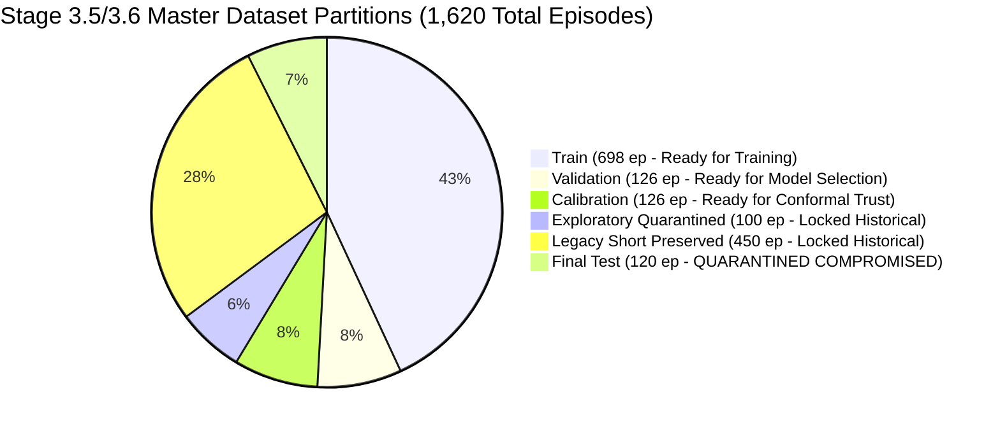
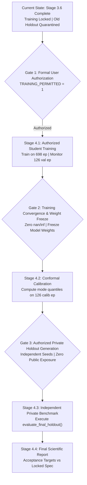

# HOROS PROBE-1 — Research-002
## Stage 3.6 Deliverable 03: Stage 4 Readiness Assessment

**Program:** HOROS Physical Interaction Data Engine (PIDE)  
**Research Program:** PROBE-1 — Autonomous Robotic Manipulation World Model  
**Stage:** Stage 3.6 — Blind Holdout Quarantine & Evaluation Integrity Recovery  
**Document Identifier:** `HOROS-P1-R002-STAGE36-REP-03-STAGE4-READINESS`  
**Date:** 2026-11-25  
**Governance State:** `TRAINING_PERMITTED = 0` | `EXECUTION_AUTHORIZED = 0` | `NEW_HOLDOUT_GENERATION = NOT_AUTHORIZED` | `FINAL_HOLDOUT_EVALUATION = BLOCKED`  

---

### 1. Architectural Distinction Matrix

Scientific progress requires rigorous differentiation between engineering readiness, training authorization, evaluation integrity, and final scientific validation. 

The current system state is explicitly defined as follows:

| Dimension | Status | Verification Criteria & Evidence | Blocking Prerequisite for Progression |
| :--- | :---: | :--- | :--- |
| **1. Engineering Readiness** | **COMPLETE** | HCTT-256 architecture (5,440,353 parameters), causal RoPE masking, sliding-window temporal dataset, HMAC-joined `AuditTargetLoader`, 4-term locked loss formulation, and read-only evaluator fully implemented and verified across 76 regression tests. | None. Core code, data loaders, and model infrastructure are complete and verified. |
| **2. Training Authorization** | **LOCKED** | `TRAINING_PERMITTED = 0`, `EXECUTION_AUTHORIZED = 0`. Hard barrier blocks all backward passes, optimizer steps, and parameter mutation. | Requires explicit, formal user command to unlock Stage 4 training. |
| **3. Evaluation Integrity** | **QUARANTINED** | The Stage 3.5 120-episode holdout is permanently quarantined under status `COMPROMISED_PUBLIC_EXPOSURE`. Code guards fail closed against all evaluation attempts on this dataset. | Generation of an independent, private holdout dataset under a separate authorized protocol. |
| **4. Final Scientific Validation** | **BLOCKED** | Zero scientific benchmark claims are made. Final holdout evaluation cannot proceed until an untainted private holdout is evaluated post-training. | Completion of authorized student training followed by private holdout benchmark. |

---

### 2. Status of Training & Evaluation Partitions

The master partition ledger defined in `stage35_final_split_manifest.json` stands in the following operational state:

1. **Training Partition (698 episodes):**  
   - 349 Compliant Prelift ($T=40$, $\Delta t=0.01\text{ s}$) + 349 Peg-in-Hole ($T=30$, $\Delta t=0.01\text{ s}$).  
   - 100% verified, disjoint, and fully prepared for Stage 4 student training.
2. **Validation Partition (126 episodes):**  
   - 75 Compliant Prelift + 51 Peg-in-Hole.  
   - Reserved exclusively for learning rate scheduling, early stopping, and hyperparameter monitoring.
3. **Calibration Partition (126 episodes):**  
   - 75 Compliant Prelift + 51 Peg-in-Hole.  
   - Reserved exclusively for post-training conformal quantile calibration (modes 0..4).
4. **Historical Preserved Partitions (550 episodes):**  
   - 100 episodes Stage 3.4 exploratory test (quarantined against train/val/calib).
   - 450 episodes Stage 3.3 Prelift $T=20$ (preserved historical records).
5. **Compromised Final Holdout (120 episodes):**  
   - **PERMANENTLY QUARANTINED.** Code guards reject any attempt to train, validate, calibrate, or benchmark on these episodes.

---

### 3. Stage 4 Phase Execution Roadmap

Progression to HOROS Stage 4 must follow a staged, fail-closed sequence:

#### Detailed Stage 4 Gate Criteria:

- **Gate 1 (Training Authorization):**  
  Model parameters must not be trained until the user issues the explicit instruction to commence Stage 4 training.
- **Gate 2 (Model Convergence & Checkpoint Freeze):**  
  Training must proceed without NaN/Inf, adhere strictly to locked 4-term loss weights (`1.0*L_sim + 0.5*L_mode + 0.25*L_sysid + 0.10*L_distill`), and produce frozen checkpoint hashes.
- **Gate 3 (Private Holdout Integrity):**  
  A new blind holdout dataset must be generated using an uncommitted seed pool, independent CSPRNG salt, and strictly private offline storage.
- **Gate 4 (Scientific Validation):**  
  Evaluation must be executed strictly through `HCTTReadOnlyEvaluator.evaluate_final_holdout()`, comparing against locked spec thresholds (e.g., Multi-horizon MSE reduction $\ge 40\%$, Mode Macro-F1 $\ge 0.85$, SysID $R^2 \ge 0.60$).

---

### 4. Stage 3.6D Addendum: Quarantine Registry Integrity Anchoring

On 2026-11-25, Stage 3.6D closed the remaining quarantine integrity blocker:
1. **Authenticated Ground Truth:** All 120 archive digests, 120 privileged target digests, 120 sample IDs, and 120 seeds in `holdout_quarantine_record.json` were cross-verified against disk artifacts and the canonical manifest with 100% agreement.
2. **Cryptographic Fingerprint Pinned:** The canonical registry byte sequence was hashed and pinned in source code:
   `EXPECTED_QUARANTINE_REGISTRY_SHA256 = "f46319f0dcbf37ccb336807287ff7ea7cfae25f96150f0e747c32cd9d61a3f8c"`.
3. **Atomic Fail-Closed Verification:** `read_and_verify_quarantine_registry()` reads registry bytes once, hashes prior to JSON parsing, validates complete schema invariants, and rejects path redirection.
4. **Regression Verification:** Full suite P40–P48 (122 tests) passed with zero failures.
5. **Governance Invariance:** Model training remains strictly locked (`TRAINING_PERMITTED = 0`, `EXECUTION_AUTHORIZED = 0`). Final holdout evaluation remains blocked.

