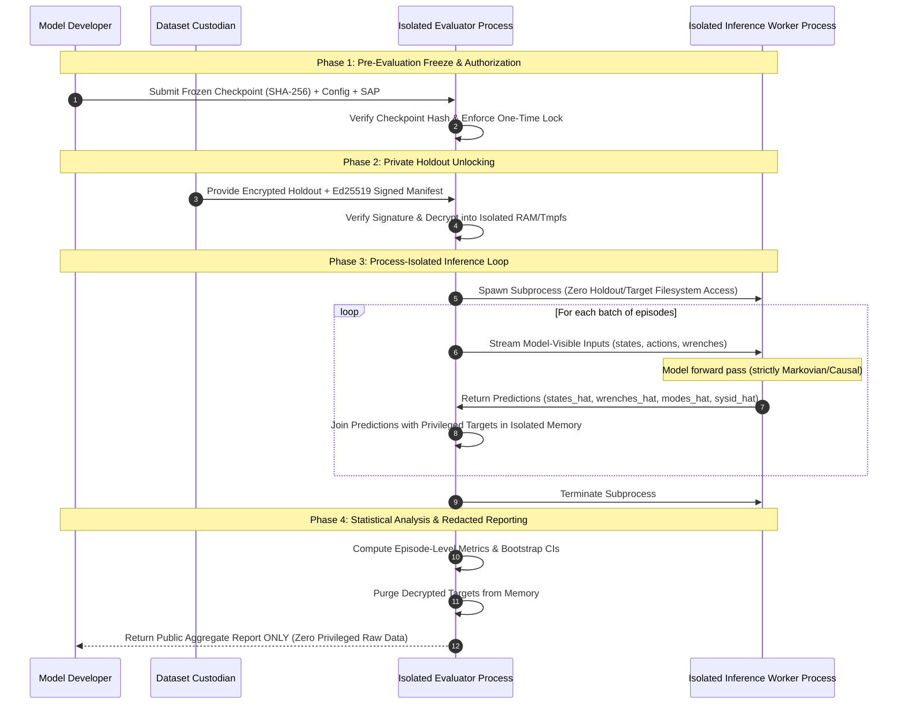
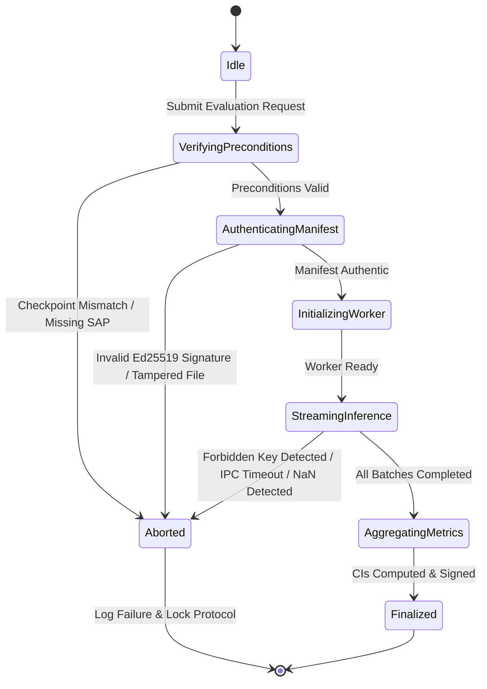

# HOROS PROBE-1 — Research-002
## Stage 3.7 Deliverable 02: Independent Blind Evaluation Protocol

**Program:** HOROS Physical Interaction Data Engine (PIDE)  
**Research Program:** PROBE-1 — Autonomous Robotic Manipulation World Model  
**Stage:** Stage 3.7 — Independent Blind Evaluation Protocol Design  
**Document Identifier:** `HOROS-P1-R002-STAGE37-REP-02-EVALUATION-PROTOCOL`  
**Date:** 2026-11-25  
**Governance State:** `TRAINING_PERMITTED = 0` | `EXECUTION_AUTHORIZED = 0` | `NEW_HOLDOUT_GENERATION = NOT_AUTHORIZED` | `FINAL_HOLDOUT_EVALUATION = BLOCKED`  
**Security Classification:** FORMAL BENCHMARK PROTOCOL SPECIFICATION  

---

### 1. Protocol Architecture & Operational Philosophy

The integrity of a scientific world model depends on the absolute separation between model optimization and final benchmark evaluation. When evaluation data is accessible during development, subtle optimization leakage (hyperparameter selection, checkpoint cherry-picking, early stopping alignment, or direct data memorization) invalidates all generalizability claims.

The HOROS PROBE-1 Stage 3.7 protocol establishes an **air-gapped, process-isolated, one-time blind evaluation architecture**.

---

### 2. Isolated Evaluator vs. Model Inference Worker Architecture

To guarantee that the candidate model cannot inspect privileged targets, simulation seeds, or dataset metadata through memory inspection or filesystem scanning, evaluation is partitioned into two operating system processes:

#### 2.1 The Isolated Evaluator Process (Parent Process)
- **Privilege Level:** Restricted Evaluator Role.
- **Access Rights:**
  - Read access to the private encrypted holdout volume.
  - Access to the Ed25519 public verification key.
  - In-memory access to privileged target data (`step_mu_true`, `step_mass_kg`, `modes`).
- **Responsibilities:**
  - Authenticate the private holdout manifest signature.
  - Parse and validate cryptographic checksums of each episode archive.
  - Strip all privileged keys, metadata, seeds, and canonical episode identifiers.
  - Stream pure tensor payloads to the inference worker.
  - Ingest predictions, compute residual errors, calculate contact-mode confusion matrices, and run bootstrap statistical routines.
  - Generate the public redacted aggregate benchmark report.

#### 2.2 The Isolated Inference Worker Process (Child Subprocess)
- **Privilege Level:** Zero-Trust Model Runtime.
- **Access Rights:**
  - Filesystem access restricted to candidate weights, architecture definitions, and PyTorch runtime libraries.
  - **Zero filesystem access** to the private holdout directory, private manifest, or target storage.
  - Zero network access (sandboxed loopback / pipe communication only).
- **Interface Protocol:**
  - Communicates with the parent Evaluator strictly via standard streams (`stdin` / `stdout`) or a private Unix domain socket / named pipe using a strict JSON-RPC / Protobuf / memory-mapped tensor buffer.
  - **Input Payload:** Strict tensor dictionary:
    $$\mathcal{X} = \{\text{"states"}: \mathbf{s}_{1:T}, \text{"actions"}: \mathbf{a}_{1:T-1}, \text{"wrenches"}: \mathbf{w}_{1:T}, \text{"task"}: \text{task\_id}\}$$
  - **Output Payload:** Strict prediction dictionary:
    $$\hat{\mathcal{Y}} = \{\hat{\mathbf{s}}_{t+H}, \hat{\mathbf{w}}_{t+H}, \hat{\mathbf{m}}_{t+H}, \hat{\mu}, \hat{m}_{\text{obj}}\} \quad \forall H \in \{1, 3, 5, 10, 20\}$$

#### 2.3 Strict Key Stripping & Anti-Leakage Verification
Before any payload enters the communication channel to the inference worker, the Evaluator executes an assertion check against `FORBIDDEN_MODEL_INPUT_KEYS` defined in `contracts.py`:
- `modes`, `target_modes`, `target_mu`, `target_mass`, `friction_mu`, `mu_true`, `initial_mu_true`, `step_mu_true`, `mass_kg`, `object_mass`, `initial_mass_kg`, `step_object_mass_kg`, `clearance_mm`, `clearance`, `step_contact_stratum`, `contact_mode`, `seed`, `episode_id`, `canonical_episode_id`, `slot_alias`, `provenance_hash`, `rewards`, `env_metadata`.

If any forbidden key is detected in the input payload, the Evaluator immediately triggers an unrecoverable `SecurityViolationAbort` and terminates the run.

---

### 3. The One-Time Evaluation Principle & Anti-Overfitting Safeguards

#### 3.1 The Scientific Rationale
In classical machine learning competitions and rigorous physical science validation, repeated querying of a test set transforms the test set into a training set through researcher-in-the-loop gradient descent. Each submission leaks information about test error, enabling post-hoc hyperparameter tuning, model checkpoint selection, or architectural adjustments that overfit the test sample.

#### 3.2 Formal Rules of the One-Time Protocol
1. **Single Evaluation Shot:** A given blind holdout dataset release ($V_{\text{eval}}$) may be queried **exactly once** by candidate model $M^*$.
2. **Failure is a Scientific Finding:** If candidate model $M^*$ fails to meet the pre-registered benchmark acceptance criteria (e.g. MSE reduction $\ge 40\%$, Mode Macro-F1 $\ge 0.85$, SysID $R^2 \ge 0.60$), that outcome is an immutable empirical result. It is not an invitation to tweak hyperparameters and re-evaluate on the same holdout.
3. **Lockout Enforcement:** The Evaluator maintains a cryptographically signed execution log (`evaluation_audit_trail.jsonl`). Once a checkpoint hash is evaluated against holdout manifest hash $\mathcal{H}_{\text{holdout}}$, the pair $(M^*_{\text{hash}}, \mathcal{H}_{\text{holdout}})$ is permanently marked `CONSUMED`. Subsequent evaluation attempts on that holdout are rejected with `EvaluationAlreadyExecutedError`.
4. **Subsequent Evaluations Require New Holdout Generation:** If subsequent architectural iterations must be evaluated, an entirely new private holdout dataset must be synthesized by the Dataset Custodian under a new, distinct seed distribution.

---

### 4. Evaluator Output Schema & Privacy Preservation

The Evaluator returns strictly high-level, aggregate statistical metrics. The output schema is restricted to prevent reconstruction attacks:

#### 4.1 Permitted Public Outputs
- Global aggregate metrics across tasks (Multi-horizon MSE, Macro-F1, Latent $R^2$, AUROC).
- Stratum-level aggregate metrics (Nominal, Probe, Nonstationary, Impact, Wedging).
- Horizon-level breakdown ($H \in \{1, 3, 5, 10, 20\}$).
- Nonparametric $95\%$ bootstrap confidence intervals ($B = 10,000$ resamples at episode level).
- Pass/Fail gate determination against pre-registered criteria.
- Execution metadata: Checkpoint SHA-256, Manifest signature verification status, evaluation timestamp, total episode count, total evaluated inference timesteps.

#### 4.2 Strictly Prohibited Outputs
- Individual per-episode trajectory predictions or errors.
- Individual per-episode ground truth friction or mass labels.
- Episode rankings (e.g., "Top 5 worst episodes" or "Episode 42 failure case").
- High-resolution confusion matrix counts with cell values $< 5$ (to prevent cell reconstruction).
- Raw simulation seeds or simulator initial conditions.

---

### 5. Failure Handling & Abort State Machine

The evaluation workflow adheres to a strict fail-closed state machine:

Any exception during execution triggers immediate process termination, deletion of decrypted in-memory artifacts, and issuance of an unredacted incident log for security review.
