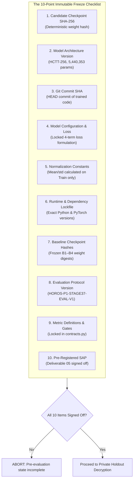

# HOROS PROBE-1 — Research-002
## Stage 3.7 Deliverable 06: Blind Evaluation Operational Runbook

**Program:** HOROS Physical Interaction Data Engine (PIDE)  
**Research Program:** PROBE-1 — Autonomous Robotic Manipulation World Model  
**Stage:** Stage 3.7 — Independent Blind Evaluation Protocol Design  
**Document Identifier:** `HOROS-P1-R002-STAGE37-OPS-06-EVALUATION-RUNBOOK`  
**Date:** 2026-11-25  
**Governance State:** `TRAINING_PERMITTED = 0` | `EXECUTION_AUTHORIZED = 0` | `NEW_HOLDOUT_GENERATION = NOT_AUTHORIZED` | `FINAL_HOLDOUT_EVALUATION = BLOCKED`  
**Security Classification:** OPERATIONAL PROCEDURE & RUNBOOK (STAGE 4 EXECUTION)  

---

### 1. Purpose & Operational Prerequisites

This runbook provides the definitive, step-by-step procedure for conducting the future authorized blind evaluation of HOROS World Model vNext (HCTT-256) during Stage 4.

**Prerequisites Before Executing This Runbook:**
1. Student model training has completed under formal user authorization (`TRAINING_PERMITTED = 1`).
2. Training loss has converged with zero `NaN` or `Inf` anomalies across all epochs.
3. Conformal calibration has completed on the dedicated 126-episode calibration partition.
4. The candidate model weights have been permanently frozen and cryptographically hashed.
5. The replacement private holdout ($N = 240$) has been generated by the Dataset Custodian and cryptographically signed.

---

### 2. The 10-Point Pre-Evaluation Freeze Checklist

Before unlocking the private holdout volume, the Evaluator must verify that all ten components of the research state are permanently frozen:



#### Verification Command (Automated Pre-Flight Check):
```powershell
python -m src.world_model_vnext.runner --verify-freeze-manifest \
    --checkpoint checkpoints/hctt256_student_final.pt \
    --sap-document experiments/stage37_blind_evaluation/stage37_statistical_analysis_plan.md \
    --protocol-version HOROS-P1-STAGE37-EVAL-V1
```

---

### 3. Step-by-Step Execution Sequence

#### Phase 1: Holdout Ingestion & Manifest Authentication
1. **Locate Signed Manifest:** The Evaluator reads the signed manifest from the private vault root:
   ```text
   C:\projects\horos_private_vault\stage4_holdout\signed_manifest.json
   ```
2. **Verify Ed25519 Signature:**
   The Evaluator validates the manifest's cryptographic signature against `HOROS_EVAL_PUBKEY` pinned in `contracts.py`.
   - If invalid: Raise `ManifestSignatureVerificationError` and abort.
3. **Verify Archive Streaming Digests:**
   For all $240$ encrypted episode archives, verify that `SHA256(archive_bytes)` exactly matches the manifest digest table.
   - If any digest fails: Raise `CorruptedHoldoutArchiveError` and abort.

#### Phase 2: Isolated Inference Worker Launch
1. **Spawn Sandboxed Subprocess:**
   The Evaluator spawns the inference worker using Python's `subprocess` module with restricted environment variables and zero filesystem access to the private holdout root:
   ```python
   worker_proc = subprocess.Popen(
       [sys.executable, "-m", "src.world_model_vnext.inference_worker", "--checkpoint-hash", expected_hash],
       stdin=subprocess.PIPE,
       stdout=subprocess.PIPE,
       stderr=subprocess.PIPE,
       cwd=SANDBOX_WORKSPACE_DIR,
   )
   ```
2. **Perform Handshake:**
   Verify worker startup, architecture compatibility, and weight digest alignment.

#### Phase 3: Streaming Blind Inference Loop
1. **Batch Iteration ($B = 16$ episodes):**
   - Evaluator decrypts episode data into RAM.
   - **Key Stripping:** Evaluator strips all keys listed in `FORBIDDEN_MODEL_INPUT_KEYS`.
   - Evaluator formats model-visible input payload:
     $$\mathcal{X} = \{\text{"states"}: \mathbf{s}_{1:T}, \text{"actions"}: \mathbf{a}_{1:T-1}, \text{"wrenches"}: \mathbf{w}_{1:T}, \text{"task"}: \text{task\_id}\}$$
   - Evaluator streams $\mathcal{X}$ across IPC pipe to inference worker.
2. **Prediction Ingestion:**
   - Worker runs forward pass under `torch.no_grad()`.
   - Worker returns prediction dictionary $\hat{\mathcal{Y}}$ across IPC pipe.
   - Evaluator receives predictions and aligns with privileged ground truth stored in parent memory.

#### Phase 4: Statistical Metric Calculation & Bootstrapping
1. **Episode-Level Residual Computation:**
   - Unpadded Multi-horizon MSE for $H \in \{1, 3, 5, 10, 20\}$.
   - 5-class contact-mode confusion matrix.
   - Latent $\mu$ and mass $m_{\text{obj}}$ predictions.
   - OOD prediction residual scores.
2. **Stratified Cluster Bootstrap:**
   - Run $B = 10,000$ bootstrap resamples at the episode level.
   - Compute BCa $95\%$ confidence intervals for all primary metrics.
3. **Gate Threshold Comparison:**
   - Compare observed metrics and lower confidence bounds against locked gate targets.

#### Phase 5: Redacted Reporting & Lockout Enforcement
1. **Generate Public Benchmark Report:**
   Write aggregate summary to:
   ```text
   experiments/stage4_evaluation/final_blind_evaluation_report.md
   ```
2. **Zero-Trace Memory Purge:**
   Explicitly overwrite and delete all decrypted arrays, tensors, and privileged labels from RAM:
   ```python
   del privileged_targets_table
   del decrypted_archive_buffers
   gc.collect()
   ```
3. **Audit Trail Signing & Lockout:**
   Append execution entry to `evaluation_audit_trail.jsonl`, sign audit log with Evaluator session key, and mark the holdout as `CONSUMED`.

---

### 4. Emergency Abort & Incident Protocol

If any of the following events occur during evaluation:
- IPC socket disconnect or subprocess unexpected exit.
- `NaN` or `Inf` floating-point value encountered in worker predictions.
- Memory leak or RAM exhaustion exceeding $80\%$ system capacity.
- Execution timeout exceeding $60.0\text{ seconds}$ on a single batch.

**Immediate Abort Actions:**
1. Terminate inference worker subprocess via `SIGKILL`.
2. Delete all decrypted temporary files in scratch or RAM.
3. Write incident log `experiments/stage4_evaluation/EVALUATION_ABORT_INCIDENT.log`.
4. Lock the evaluation pipeline; require manual developer review before any retry.

---

### 5. Stage 3.7A Addendum: Hardened Runbook Sequence

1. **Pre-Evaluation Holdout Release Reservation:**
   ```python
   lock = DurableHoldoutLock(ledger_path=VAULT_LEDGER_PATH)
   lock.reserve_release(
       holdout_release_id=signed_envelope["payload"]["holdout_id"],
       checkpoint_sha256=checkpoint_hash,
       protocol_version="HOROS-P1-STAGE37-EVAL-V1",
   )
   ```
2. **Burn-on-Access Lock Transition:**
   Before decrypting the first archive, invoke:
   ```python
   lock.record_private_data_access(holdout_release_id)
   ```
   *Note: If the process aborts or crashes after this point, the release is permanently burned and cannot be evaluated again.*
3. **Strict IPC Tensor Validation:**
   Before every transmission over the pipe, execute:
   ```python
   validate_inference_ipc_payload(batch_payload)
   ```
4. **Final Consumption:**
   Upon successful report generation, invoke:
   ```python
   lock.mark_consumed(holdout_release_id, report_digest=report_sha256)
   ```


---

### 8. Stage 3.7B Addendum: Production Evaluator Execution Procedure

1. **Pre-Flight Ledger Verification:**
   - Evaluator verifies existing production ledger using DurableHoldoutLock.open_production_ledger(path).
   - If missing, corrupt, or unreadable, execution aborts immediately with LedgerMissingError or LedgerCorruptedError.
2. **One-Time Release Reservation:**
   - Release is reserved atomically across OS processes prior to private data access.
3. **OS Vault Isolation Activation:**
   - Evaluator invokes apply_os_vault_isolation(vault_path) before spawning IsolatedInferenceWorker.
4. **Strict Model Input IPC & Worker Inference:**
   - Inputs are schema-validated with validate_inference_ipc_payload before serialization and again inside worker.
5. **Consumption Finalization & Audit Appending:**
   - Upon metric computation, verify_redacted_benchmark_output verifies the report, which is hashed and marked CONSUMED in the durable ledger.
