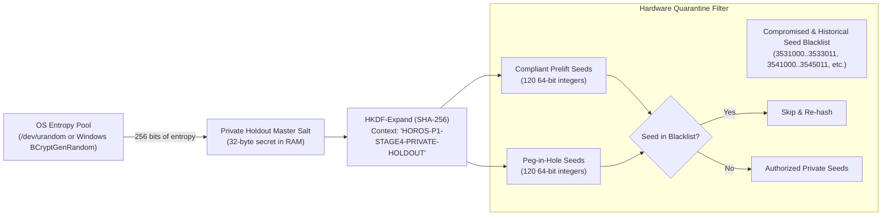

# HOROS PROBE-1 — Research-002
## Stage 3.7 Deliverable 03: Replacement Holdout Generation Specification

**Program:** HOROS Physical Interaction Data Engine (PIDE)  
**Research Program:** PROBE-1 — Autonomous Robotic Manipulation World Model  
**Stage:** Stage 3.7 — Independent Blind Evaluation Protocol Design  
**Document Identifier:** `HOROS-P1-R002-STAGE37-SPEC-03-HOLDOUT-GENERATION`  
**Date:** 2026-11-25  
**Governance State:** `TRAINING_PERMITTED = 0` | `EXECUTION_AUTHORIZED = 0` | `NEW_HOLDOUT_GENERATION = NOT_AUTHORIZED` | `FINAL_HOLDOUT_EVALUATION = BLOCKED`  
**Security Classification:** FUTURE GENERATION SPECIFICATION (DESIGN-ONLY — ZERO REAL SEEDS)  

---

### 1. Scope & Core Directives

This specification governs the future authorized synthesis of the replacement blind evaluation dataset for HOROS PROBE-1. 

**Mandatory Governance Directives:**
1. **Design-Only Stage:** No simulation execution, trajectory generation, or seed synthesis is authorized during Stage 3.7.
2. **Permanent Ineligibility of Compromised Seeds:** All seed ranges exposed during Stage 3.5 (`3531000..3533011` for Prelift, `3541000..3545011` for Peg-in-Hole) and all historical development seeds are permanently quarantined and blacklisted.
3. **Zero Actual Seeds in Code or Git:** No candidate, temporary, or real future seed values may be written to source code, markdown reports, logs, or Git commits.

---

### 2. Task-Specific Physical Condition Matrices

To ensure comprehensive physical generalization, the replacement holdout must span distinct operational strata across both benchmark manipulation tasks.

#### 2.1 Task 1: Compliant Prelift (`compliant_prelift`)
- **Physics Engine:** High-fidelity elastomeric contact solver with Dahl/LuGre tangential compliance and velocity-dependent friction (Stribeck model).
- **Episode Duration:** $T = 40$ steps ($400\text{ ms}$ at $\Delta t = 0.01\text{ s}$).
- **Target Stratum Distribution (Total: $N_1 = 120$ episodes):**

| Stratum ID | Stratum Name | Target Share | Target Count | Physical Characteristics & Boundary Conditions | Contact Mode Transitions |
| :--- | :--- | :---: | :---: | :--- | :--- |
| **CP-S1** | Nominal Prelift | $25\%$ | $30$ ep | Static normal grasp load ($F_N \in [5.0, 15.0]\text{ N}$), stationary friction ($\mu \in [0.45, 0.65]$), nominal object mass ($m \in [0.15, 0.35]\text{ kg}$). Upward prelift shear ramp. | Mode 0 (Free) $\to$ Mode 1 (FirstContact) $\to$ Mode 2 (Sticking). |
| **CP-S2** | Active Friction Probe | $25\%$ | $30$ ep | Perturbed normal force dynamics ($F_N$ oscillation $\pm 20\%$), diverse materials ($\mu \in [0.15, 0.85]$), micro-shear test motions designed to probe latent friction identifiability. | Mode 2 (Sticking) $\leftrightarrow$ Mode 3 (Sliding) limit cycles. |
| **CP-S3** | Nonstationary Shift | $25\%$ | $30$ ep | Abrupt or continuous mid-trajectory friction collapse ($\Delta \mu = -40\%$ to $-60\%$ simulating lubricant or surface change) and payload mass drops ($\Delta m = -50\%$). | Mode 2 (Sticking) $\to$ Mode 3 (Sliding) sudden slip transition. |
| **CP-S4** | Extreme Shear & Recovery | $25\%$ | $30$ ep | High tangential shear rate, incipient slip boundary, compliant pad saturation, and closed-loop reflexive normal force recovery to restore adhesion. | Mode 3 (Sliding) $\to$ Mode 2 (Sticking) re-grasp recovery. |

#### 2.2 Task 2: Peg-in-Hole Assembly (`peg_in_hole`)
- **Physics Engine:** Multi-body contact solver with penalty-based compliant impact and Coulomb dry friction.
- **Episode Duration:** $T = 30$ steps ($300\text{ ms}$ at $\Delta t = 0.01\text{ s}$).
- **Target Stratum Distribution (Total: $N_2 = 120$ episodes):**

| Stratum ID | Stratum Name | Target Share | Target Count | Physical Characteristics & Boundary Conditions | Contact Mode Transitions |
| :--- | :--- | :---: | :---: | :--- | :--- |
| **PIH-S1** | Nominal Insertion | $25\%$ | $30$ ep | Chamfer-guided alignment, small initial positional offset ($\Delta x, \Delta y \in [-1.5, +1.5]\text{ mm}$), nominal radial clearance ($c \in [0.4, 0.8]\text{ mm}$). | Mode 0 (Free) $\to$ Mode 1 (FirstContact) $\to$ Mode 3 (Sliding). |
| **PIH-S2** | Transient Dynamic Impact | $25\%$ | $30$ ep | High-velocity approach ($v_z \in [0.08, 0.15]\text{ m/s}$), initial misaligned contact with chamfer edge or hole rim, sharp impulsive contact wrenches ($F_z > 40\text{ N}$). | Mode 0 (Free) $\to$ Mode 4 (Impact) $\to$ Mode 1 (FirstContact). |
| **PIH-S3** | Tight Clearance Wedging | $25\%$ | $30$ ep | Ultra-tight tolerance ($c \in [0.10, 0.25]\text{ mm}$), angular tilt ($\theta_{\text{tilt}} \in [1.5^\circ, 3.5^\circ]$) exceeding two-point contact wedging limit. | Mode 3 (Sliding) $\to$ Mode 5 (Jamming/Wedging). |
| **PIH-S4** | Multi-Point Jam & Recovery | $25\%$ | $30$ ep | High friction ($\mu > 0.40$), lateral binding force buildup, compliance control compliance response, and helical dithering recovery trajectory. | Mode 5 (Jamming) $\to$ Mode 3 (Sliding) $\to$ Mode 0 (Release). |

---

### 3. Sample Size Determination & Statistical Power Analysis

#### 3.1 Why 120 Episodes Was Methodologically Inadequate
The Stage 3.5 holdout partitioned $120$ episodes across two tasks ($60$ episodes each) and six unequal sub-strata ($12$ to $30$ episodes per cell). 
- A stratum size of $n = 12$ episodes produces an empirical standard error of the mean proportional to $\sigma / \sqrt{12} \approx 0.29 \sigma$.
- In statistical hypothesis testing against baseline B3, detecting a modest improvement ($d = 0.35$ Cohen's $d$) at significance level $\alpha = 0.05$ with $n = 12$ yields statistical power of only $1 - \beta \approx 0.22$ (an unacceptably high $78\%$ Type II error rate).
- Furthermore, nonparametric bootstrap $95\%$ confidence intervals for Macro-F1 with $n = 12$ span widths of $\pm 0.14$, making it impossible to statistically distinguish a true score of $0.85$ from a baseline of $0.72$.

#### 3.2 Formal Power Calculations for Replacement Holdout ($N = 240$)
To ensure statistically rigorous, publication-grade discrimination between HCTT-256 and the strongest frozen baseline ($B3$):

1. **Power Objective:**
   Achieve statistical power $1 - \beta \ge 0.90$ at family-wise significance level $\alpha = 0.05$ (two-tailed) to detect a standardized effect size of $d \ge 0.45$ (corresponding to a $\ge 40\%$ reduction in multi-horizon MSE over B3).
2. **Formula for Two-Sample / Paired Episode-Level Comparison:**
   $$n = \left( \frac{z_{1 - \alpha/2} + z_{1 - \beta}}{\delta / \sigma_d} \right)^2 = \left( \frac{1.96 + 1.282}{0.45} \right)^2 \approx \left( \frac{3.242}{0.45} \right)^2 \approx 51.9 \text{ episodes per task}$$
3. **Stratum-Level Precision Requirement:**
   To guarantee that each individual stratum (e.g. Nonstationary Shift, Wedging) has sufficient samples to estimate stratum Macro-F1 within a precision margin of $E \le \pm 0.05$ at $95\%$ confidence:
   $$n_{\text{stratum}} \ge \frac{z_{0.975}^2 \cdot p(1-p)}{E^2} = \frac{(1.96)^2 \cdot 0.15 \cdot 0.85}{(0.05)^2} \approx \frac{3.8416 \cdot 0.1275}{0.0025} \approx 19.6 \to 30 \text{ episodes}$$
4. **Recommended Total Dataset Size:**
   - Compliant Prelift: $4 \text{ strata} \times 30 \text{ episodes} = 120 \text{ episodes}$.
   - Peg-in-Hole: $4 \text{ strata} \times 30 \text{ episodes} = 120 \text{ episodes}$.
   - **Total Private Blind Holdout:** **$N = 240$ episodes** ($8,400$ total timesteps: $4,800$ Prelift + $3,600$ Peg-in-Hole).

---

### 4. Cryptographic Seed Generation Protocol (CSPRNG Architecture)

When future holdout generation is formally authorized, simulation seeds must be generated via a true Cryptographically Secure Pseudo-Random Number Generator (CSPRNG) rather than standard deterministic PRNGs (`random.seed()` or static sequences).

#### 4.1 CSPRNG Derivation Architecture

#### 4.2 Seed Space Non-Overlap Verification
The seed generator must verify that no generated seed falls within:
- Quarantined Stage 3.5 Holdout seeds (`_COMPROMISED_SEEDS_SET`).
- Stage 3.3 / Stage 3.5 training seeds (`3510000..3529999`, etc.).
- Stage 3.5 validation seeds.
- Stage 3.5 calibration seeds.
- Stage 3.4 exploratory seeds.

---

### 5. Pre-Registered Simulation Acceptance & Rejection Filters

Not all simulated trajectories are physically valid. Simulator numerical instability or non-physical penetration must be rejected before an episode is accepted into the final holdout.

#### 5.1 Hard Rejection Criteria (Episode Discarded and Regenerated)
1. **Numerical Explosion:** Any `NaN`, `Inf`, or unnormalized floating-point value in states, actions, or wrenches.
2. **Kinematic Penetration Violation:** Unconstrained mesh penetration exceeding $1.0\text{ mm}$ (violates physical non-interpenetration).
3. **Energy Drift Violation:** Mechanical work discrepancy $| \Delta E_{\text{kinetic}} + \Delta E_{\text{potential}} - W_{\text{ext}} - W_{\text{dissipated}} | / E_{\text{total}} > 0.05$ (violates energy conservation).
4. **Wrench Spike Anomaly:** Force magnitude $|F| > 150\text{ N}$ or torque magnitude $|\tau| > 15\text{ N}\cdot\text{m}$ lasting for $\le 1$ timestep with zero subsequent contact (unphysical constraint impulse artifact).
5. **Dwell Invariance:** Zero relative motion ($\dot{x} < 10^{-5}\text{ m/s}$) throughout entire episode despite non-zero commanded actuation (stalled simulation thread).

#### 5.2 Acceptance Verification
Only episodes that pass all five hard filters without warning flags are accepted into the private holdout volume. Rejections must be logged with an anonymous collision diagnostics code to verify that rejection rates do not exceed $5\%$ across any stratum.
