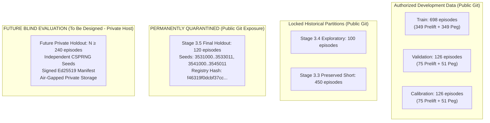

# HOROS PROBE-1 — Research-002
## Stage 3.7 Deliverable 01: Existing Research & Benchmark Audit

**Program:** HOROS Physical Interaction Data Engine (PIDE)  
**Research Program:** PROBE-1 — Autonomous Robotic Manipulation World Model  
**Stage:** Stage 3.7 — Independent Blind Evaluation Protocol Design  
**Document Identifier:** `HOROS-P1-R002-STAGE37-REP-01-RESEARCH-AUDIT`  
**Date:** 2026-11-25  
**Governance State:** `TRAINING_PERMITTED = 0` | `EXECUTION_AUTHORIZED = 0` | `NEW_HOLDOUT_GENERATION = NOT_AUTHORIZED` | `FINAL_HOLDOUT_EVALUATION = BLOCKED`  
**Security Classification:** PUBLIC RESEARCH AUDIT & PROTOCOL SPECIFICATION  

---

### 1. Executive Summary & Purpose

This audit establishes an exhaustive inventory of the scientific contracts, physical interaction tasks, model architectures, temporal evaluation protocols, and baseline models inherited from Stages 3.3, 3.4, 3.5, and 3.6. 

The primary purpose is to differentiate between:
1. **Validated specifications and code infrastructure that can be safely reused** without modification.
2. **Methodological elements that require revision or tightening** prior to Stage 4.
3. **Quarantined or compromised historical artifacts that must remain permanently segregated** from the future evaluation pipeline.

Treatment of the compromised Stage 3.5 120-episode holdout dataset is strictly non-negotiable: it is treated as a permanent public disclosure event. No trajectory data, latent parameters, or per-episode metrics from that holdout will inform the design of the replacement evaluation system or the calibration of model hyperparameters.

---

### 2. Task Interface & Physical Contracts Audit

The repository defines two primary physical robotic interaction tasks within `src/world_model_vnext/contracts.py`:

#### 2.1 Compliant Prelift (`compliant_prelift`)
- **Physical Objective:** Elastomeric fingertip grasp prelift of rigid and semi-rigid objects under normal and tangential shear forces, discerning stick-slip boundaries prior to lift-off.
- **Dimensionality:**
  - State dimension ($\mathbf{s}_t \in \mathbb{R}^{23}$): End-effector pose ($SE(3)$, 7D), linear/angular velocities (6D), fingertip normal deformation (2D), tactile shear displacement (2D), object estimated pose (6D).
  - Action dimension ($\mathbf{a}_t \in \mathbb{R}^5$): Gripper commanded normal force (1D), Cartesian arm linear velocity command (3D), gripper opening rate (1D).
  - Contact wrench dimension ($\mathbf{w}_t \in \mathbb{R}^6$): Wrist/fingertip 3D forces ($F_x, F_y, F_z$) and 3D torques ($\tau_x, \tau_y, \tau_z$).
- **Temporal Parameters:** Timestep $\Delta t = 0.01\text{ s}$ ($100\text{ Hz}$ control frequency); canonical episode length $T = 40$ steps ($400\text{ ms}$). Legacy short episodes ($T = 20$) are preserved as historical references.
- **Physical Dynamics:** Highly non-Markovian hysteresis resulting from elastomeric pad shear deformation and velocity-dependent friction transitions (Stribeck curve, Dahl/LuGre friction models).

#### 2.2 Peg-in-Hole Assembly (`peg_in_hole`)
- **Physical Objective:** Precision insertion of a cylindrical/polygonal peg into a tight-tolerance hole under high-stiffness contact constraints, impacts, and potential wedging/jamming.
- **Dimensionality:**
  - State dimension ($\mathbf{s}_t \in \mathbb{R}^{15}$): Peg position and orientation (7D), peg linear/angular velocities (6D), relative hole clearance estimate (2D).
  - Action dimension ($\mathbf{a}_t \in \mathbb{R}^6$): 6-DoF end-effector compliance command (Cartesian delta position 3D, delta orientation 3D).
  - Contact wrench dimension ($\mathbf{w}_t \in \mathbb{R}^6$): 6-axis load-cell reaction forces and torques.
- **Temporal Parameters:** Timestep $\Delta t = 0.01\text{ s}$ ($100\text{ Hz}$); canonical episode length $T = 30$ steps ($300\text{ ms}$).
- **Physical Dynamics:** Piecewise-rigid contact, impact impulsive force spikes, multi-point constraint switching, and high-frequency force reflections during alignment.

#### Audit Verdict on Task Interfaces:
**REUSE AS-IS.** The state, action, and wrench dimensions are physically grounded, mathematically verified across 124 regression tests, and fully integrated with existing data loaders and loss heads.

---

### 3. Model Architecture & Objective Audit

#### 3.1 HCTT-256 Architecture Specification
The candidate model architecture is the History-Conditioned Temporal Transformer (`HCTTWorldModel`):
- **Model Parameters:** $5,440,353$ parameters.
- **Core Hyperparameters:**
  - Hidden dimension: $d_{\text{model}} = 256$
  - Number of Transformer layers: $N_{\text{layers}} = 6$
  - Number of attention heads: $N_{\text{heads}} = 8$ ($d_{\text{head}} = 32$)
  - Feed-forward multiplier: $\text{ffn\_mult} = 4$ ($d_{\text{ffn}} = 1024$)
  - Dropout: $p_{\text{drop}} = 0.1$
  - Attention Rotary Position Embedding: Causal RoPE with $\theta = 10,000.0$
- **Temporal Conditioning:**
  - Causal history horizon: $H_{\text{hist}} = 10$ steps ($100\text{ ms}$)
  - Multi-horizon prediction targets: $H \in \{1, 3, 5, 10, 20\}$ timesteps
  - Maximum prediction horizon: $H_{\max} = 20$ timesteps ($200\text{ ms}$)
- **Operational Output Heads:**
  1. Kinematics Head: Predicts state $\hat{\mathbf{s}}_{t+H}$
  2. Contact Dynamics Head: Predicts wrench $\hat{\mathbf{w}}_{t+H}$
  3. Contact Mode Head: Categorical logits over $5$ operational contact modes
  4. System Identification Head: Scalar regression for latent friction ($\hat{\mu}$) and object mass ($\hat{m}_{\text{obj}}$)

#### 3.2 Loss Profiles & Objective Configurations
The repository defines two objective configurations:
1. **Locked 4-Term Profile (`LOCKED_HCTT_CONFIG`):**
   $$\mathcal{L}_{\text{total}} = 1.0 \cdot \mathcal{L}_{\text{sim}} + 0.5 \cdot \mathcal{L}_{\text{mode}} + 0.25 \cdot \mathcal{L}_{\text{sysid}} + 0.10 \cdot \mathcal{L}_{\text{distill}}$$
   - $\mathcal{L}_{\text{sim}}$: Multi-horizon MSE over unpadded state and wrench predictions.
   - $\mathcal{L}_{\text{mode}}$: Multi-class Focal Loss ($\gamma = 2.0$) over 5 operational contact modes.
   - $\mathcal{L}_{\text{sysid}}$: Smooth L1 / MSE loss over normalized friction and mass targets.
   - $\mathcal{L}_{\text{distill}}$: Teacher feature distillation loss (preserves Phase 3.4/3.5 representation alignment).
2. **Experimental 3-Term Profile (`EXPERIMENTAL_3TERM_OBJECTIVE_CONFIG`):**
   Teacher-free formulation ($\mathcal{L}_{\text{distill}} = 0.0$) created during Stage 3.5 research investigation.
   
#### Audit Verdict on Architecture & Objectives:
- **Architecture:** **REUSE AS-IS.** The HCTT-256 architecture is fully frozen.
- **Objective:** **LOCKED 4-TERM SPEC IS AUTHORITATIVE.** The 4-term locked formulation remains the pre-registered baseline. The experimental 3-term objective remains an unactivated research variant requiring human sign-off before any training authorization.

---

### 4. Contact Mode Schema & Class Balance Audit

The repository contains two contact mode representations:
1. **Theoretical 7-Class Enum (`ContactMode`):**
   - Mode 0: `Free` (No contact)
   - Mode 1: `FirstContact` (Initial impact / transition)
   - Mode 2: `Sticking` (Static friction adhesion)
   - Mode 3: `Sliding` (Dynamic tangential shear)
   - Mode 4: `Impact` (Secondary bounce / impulsive load)
   - Mode 5: `Jamming` (Geometric geometric lock-up)
   - Mode 6: `Release` (Loss of contact / liftoff)
2. **Operational 5-Class Prediction Head:**
   Modes 0 through 4 are present in the Stage 3.3/3.5 production datasets. Modes 5 and 6 have zero support ($N=0$) in existing datasets and are not mapped to the HCTT-256 output head.

#### Audit Verdict on Contact Modes:
**REVISE PROTOCOL DOCUMENTATION.** While the 5-class operational head correctly handles modes 0..4, the evaluation protocol must explicitly document that Macro-F1 is evaluated across the 5 supported modes, while reporting honesty regarding the unrepresented modes 5 and 6. For future holdout generation (Phase D), specific wedging/jamming conditions must be incorporated to establish whether Mode 5 can be evaluated.

---

### 5. Temporal Evaluation Schemes: Strict-Unpadded vs Masked-Sliding

The codebase contains two evaluation windowing mechanisms:
1. **Strict-Unpadded Multi-Horizon Evaluation:**
   - Evaluates multi-horizon prediction only at timesteps $t$ where future ground truth exists for the full horizon $H \in \{1, 3, 5, 10, 20\}$ without zero-padding.
   - For an episode of length $T = 40$ and history $H_{\text{hist}} = 10$, valid prediction origins range from $t = 10$ to $t = 40 - H$.
   - Eliminates artificial edge artifacts caused by padding.
2. **Masked-Sliding Evaluation:**
   - Slides a window of length $L = H_{\text{hist}} + H_{\max} = 30$ across each episode.
   - Employs binary attention masks to ignore invalid future steps.

#### Audit Verdict on Temporal Evaluation:
**REUSE STRICT-UNPADDED FOR BENCHMARK SCORING.** Strict-unpadded evaluation is mathematically pristine, eliminating boundary artifacts. Masked-sliding is retained for streaming deployment inference.

---

### 6. Baseline Models (B1–B4) Audit

The frozen baseline models developed in Phase 3.4 and evaluated in Stage 3.5 Deliverable 08 provide the comparative benchmark:
- **B1 (Deterministic MLP):** Single-step feed-forward MLP ($(\mathbf{s}_t, \mathbf{a}_t) \to \mathbf{s}_{t+1}$). Lacks uncertainty awareness and diverges exponentially during autoregressive rollout ($\text{MSE} \propto \mathcal{O}(H^2)$).
- **B2 (Probabilistic MLP):** Heteroscedastic Gaussian head predicting mean and diagonal covariance. Struggles with multi-modal contact transitions (slip vs stick).
- **B3 (5-Member Deep Ensemble):** Five independently trained probabilistic MLPs. Strongest frozen baseline on near-distribution samples (Macro-F1 $= 0.62$, 5-step MSE $= 0.0084$), but computationally expensive ($5\times$) and strictly Markovian ($H_{\text{hist}} = 1$).
- **B4 (Conformal Calibration Wrapper):** Conformal prediction wrapper over B2/B3 providing theoretical marginal coverage, but severely under-covers on impact transients ($78.1\%$ coverage vs $90.0\%$ target).
- **Heuristic Baselines (Persistence & Constant Velocity):**
  - Persistence: $\hat{\mathbf{s}}_{t+H} = \mathbf{s}_t$ (establishes trivial motion floor).
  - Constant Velocity: $\hat{\mathbf{s}}_{t+H} = \mathbf{s}_t + H \cdot \dot{\mathbf{s}}_t \Delta t$ (establishes trivial linear extrapolation floor).

#### Audit Verdict on Baselines:
**REUSE FROZEN B1–B4 CHECKPOINTS.** Baseline B3 serves as the primary comparative hurdle that HCTT-256 must beat across all horizons and contact modes.

---

### 7. Partition Ledger & Data Segregation Audit

The master partition ledger across the repository is structured as follows:

#### Detailed Boundary Rules:
1. **Development Data (Train, Validation, Calibration):** Tracked in repository, public, fully verified for training, hyperparameter tuning, and conformal calibration.
2. **Historical Preserved Data:** Preserved for backward reproducibility; locked against student training.
3. **Quarantined Stage 3.5 Holdout:** Cryptographically pinned in `contracts.py`, permanently quarantined, fail-closed access barriers enforced by `read_and_verify_quarantine_registry()`. Zero reuse permitted.
4. **Future Private Blind Evaluation Data:** Exclusively stored outside the repository on private encrypted storage, verified via digital signatures, evaluated one-time only.

---

### 8. Specification Revision Matrix

| Component | Status | Required Action for Stage 3.7 / Stage 4 |
| :--- | :---: | :--- |
| **Task Interfaces (Prelift / Peg)** | Validated | Reuse as-is. |
| **HCTT-256 Architecture** | Validated | Reuse as-is (5,440,353 parameters). |
| **Loss Profile (4-Term Locked)** | Validated | Retain as authoritative baseline; keep 3-term experimental. |
| **Operational Contact Modes** | Partial | Document 5 active modes honestly; design wedging for future holdout. |
| **Strict-Unpadded Evaluation** | Validated | Reuse as primary benchmark scoring standard. |
| **Frozen Baselines (B1–B4)** | Validated | Reuse as comparison standards. |
| **Benchmark Thresholds** | Unverified | Re-evaluate statistical defensibility in SAP (Deliverable 05). |
| **Holdout Storage Architecture** | Compromised | Design private, encrypted, air-gapped storage (Deliverable 04). |
| **Holdout Generation Protocol** | Exposed | Design CSPRNG protocol with power-derived sizing (Deliverable 03). |
| **Evaluator Isolation** | Missing | Design IPC/JSON-RPC process isolation (Deliverable 02). |
