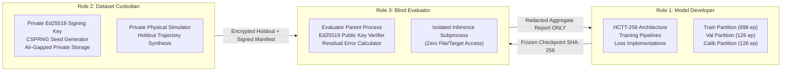
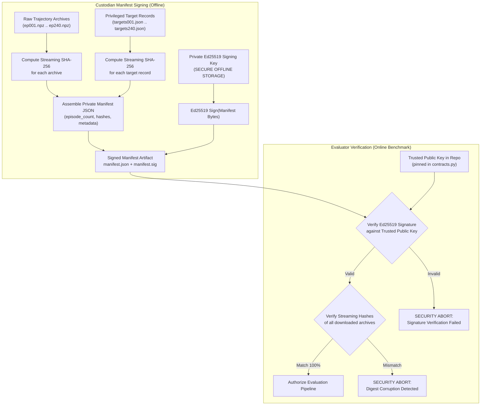

# HOROS PROBE-1 — Research-002
## Stage 3.7 Deliverable 04: Security & Data Custody Architecture

**Program:** HOROS Physical Interaction Data Engine (PIDE)  
**Research Program:** PROBE-1 — Autonomous Robotic Manipulation World Model  
**Stage:** Stage 3.7 — Independent Blind Evaluation Protocol Design  
**Document Identifier:** `HOROS-P1-R002-STAGE37-SEC-04-SECURITY-CUSTODY`  
**Date:** 2026-11-25  
**Governance State:** `TRAINING_PERMITTED = 0` | `EXECUTION_AUTHORIZED = 0` | `NEW_HOLDOUT_GENERATION = NOT_AUTHORIZED` | `FINAL_HOLDOUT_EVALUATION = BLOCKED`  
**Security Classification:** FORMAL SECURITY ARCHITECTURE & THREAT MODEL  

---

### 1. Three-Party Role Separation & Access Control

To eliminate bias, data leakage, and conflicts of interest, all operations governing dataset creation, model optimization, and scientific evaluation are strictly decoupled across three distinct operational roles.



---

### 2. Comprehensive Role Permission Matrix

| Asset or Operational Capability | Role 1: Model Developer | Role 2: Dataset Custodian | Role 3: Blind Evaluator |
| :--- | :---: | :---: | :---: |
| **Training Partition (698 ep)** | **Read / Write** | Read Only | No Access |
| **Validation Partition (126 ep)** | **Read Only** | Read Only | No Access |
| **Calibration Partition (126 ep)** | **Read Only** | Read Only | No Access |
| **Public Research Documentation** | **Read / Write** | Read Only | Read Only |
| **Model Weights & Checkpoint SHA** | **Read / Write** | No Access | **Read Only (Frozen)** |
| **Future Holdout Seed Values** | **STRICTLY PROHIBITED** | **Generate / Store** | No Access |
| **Private Holdout Raw Trajectories** | **STRICTLY PROHIBITED** | **Read / Write** | **Read Only (Ephemeral)** |
| **Private Privileged Ground Truth** | **STRICTLY PROHIBITED** | **Read / Write** | **Read Only (Isolated)** |
| **Private Ed25519 Signing Key** | **STRICTLY PROHIBITED** | **Hold / Sign** | **STRICTLY PROHIBITED** |
| **Public Ed25519 Verification Key** | Read Only | Read Only | **Verify Signatures** |
| **Encrypted Private Storage Root** | **STRICTLY PROHIBITED** | **Full Admin** | **Read Encrypted Stream** |
| **Aggregate Benchmark Report** | **Receive Report** | Read Only | **Generate & Sign** |

---

### 3. Solo-Developer Conflict-of-Interest Mitigations

In early-stage robotics research environments, model development, data generation, and evaluation may be executed by a single primary researcher. Without structural safeguards, this creates an acute conflict of interest where evaluation data is subconsciously or accidentally inspected.

To guarantee verifiable scientific integrity when operated by a single individual:

#### 3.1 Temporal Separation & Cryptographic Checkpoint Commit
1. **Pre-Generation Model Freeze:** The developer must commit the finalized model source code, architecture hyperparameters, training convergence logs, and candidate checkpoint SHA-256 to the Git repository **before** the holdout generation script is executed.
2. **Immutable Timestamping:** The Git commit timestamp and cryptographic hash serve as non-repudiable proof that the model was completely frozen prior to the existence of the evaluation dataset.

#### 3.2 Automated Cryptographic Enveloping & Air-Gapped Directories
1. **Isolated Storage Location:** Holdout synthesis outputs must write strictly to an air-gapped directory outside the project workspace (e.g., `C:\projects\horos_private_vault\holdout_vnext\`), protected by OS-level access control lists (`icacls` denying general read access).
2. **Immediate Envelope Encryption:** The generation pipeline immediately encrypts all raw trajectory NPZ files and target JSON files using AES-256-GCM under an ephemeral evaluation key.
3. **Automated Manifest Signing:** The custodian script signs the manifest via Ed25519, hashes the encrypted archives, and deletes all plaintext trajectory files from the generation workspace.

#### 3.3 Third-Party Custody & Cryptographic Escrow Option
- Where feasible, the private holdout generation script is packaged as a self-contained container/runner and executed on an independent cloud virtual machine or by an independent external collaborator who holds the private signing key and releases only the evaluation output report.

---

### 4. Cryptographic Storage & Transport Security Architecture

#### 4.1 Encryption at Rest and in Transit
- **At Rest:** All evaluation trajectories and privileged ground-truth targets are encrypted using **AES-256-GCM** (Galois/Counter Mode) with a unique 96-bit initialization vector (IV) per archive. 
- **In Transit:** Any distribution between storage hosts and the evaluator occurs over **TLS 1.3** authenticated channels with mutual TLS (mTLS).
- **Key Separation:** Encryption keys ($\mathcal{K}_{\text{enc}}$) are stored in a dedicated key management system (e.g. HashiCorp Vault, AWS KMS, or hardware security module) completely decoupled from the encrypted ciphertext archives.

#### 4.2 Ed25519 Digital Signature & Manifest Verification
Manifest tampering or unauthorized episode substitution is prevented via public-key cryptography using **Ed25519** (Edwards-curve Digital Signature Algorithm, RFC 8032):



#### 4.3 Key Rotation & Revocation Protocol
1. **Key Versioning:** Public keys are versioned in `contracts.py` (e.g., `HOROS_EVAL_PUBKEY_V1`).
2. **Revocation:** If an Ed25519 private key is suspected of disclosure or compromise, the public key is immediately moved to `REVOKED_KEYS_SET` in `contracts.py`, and all manifests signed by that key are marked `UNTRUSTED_KEY_REVOKED`.
3. **No Real Keys in Stage 3.7:** Consistent with governance restrictions, zero real private signing keys or production encryption keys are generated during Stage 3.7.

---

### 5. Access Auditing & Incident Response Protocol

#### 5.1 Immutable Evaluation Audit Trail
Every invocation of the evaluation pipeline appends an entry to an append-only, tamper-evident audit log (`evaluation_audit_trail.jsonl`):
```json
{
  "timestamp": "2026-12-01T12:00:00Z",
  "action": "EVALUATE_PRIVATE_HOLDOUT",
  "operator_id": "evaluator_process_pid_10492",
  "checkpoint_sha256": "3a7b8e...",
  "holdout_manifest_sha256": "9f2c1d...",
  "manifest_signature_valid": true,
  "episodes_ingested": 240,
  "evaluation_status": "COMPLETED_SUCCESS",
  "report_digest": "4e1a0b..."
}
```

#### 5.2 Incident Response for Accidental Disclosure
If private holdout trajectories, seeds, or privileged targets are inadvertently committed or exposed publicly:
1. **Immediate Quarantine Declaration:** The exposed dataset identifier is declared `COMPROMISED_PUBLIC_EXPOSURE` via formal addendum to `contracts.py`.
2. **Digest Blacklisting:** SHA-256 digests of all exposed files are added to the quarantine registry (`holdout_quarantine_record.json`).
3. **Code Guard Invalidation:** Automated tests and dataloaders immediately reject the compromised paths and hashes with `CompromisedHoldoutError`.
4. **Permanent Ineligibility:** The compromised dataset is never used again for benchmark claims.

---

### 6. Stage 3.7A Addendum: Ed25519 Cryptographic Verification & Solo-Developer Trust Model Hardening

1. **Asymmetric Ed25519 Signature Enforcement (`ed25519_manifest.py`):**
   - Implements authentic Ed25519 asymmetric cryptography.
   - The Dataset Custodian retains the 32-byte Ed25519 private key. The Evaluator receives only the corresponding 32-byte Ed25519 public key. The Model Developer possesses neither.
   - Manifests are canonicalized under RFC 8785 rules. Signed envelopes include `algorithm: "Ed25519"`, `key_id`, `signature`, and `payload`.
   - Key revocation is enforced through `REVOKED_ED25519_KEY_IDS`. Malformed signatures, modified manifests, untrusted keys, and algorithm substitution trigger immediate rejection.
   - HMAC test utilities are strictly quarantined as test-only tools (`compute_hmac_test_manifest_signature`).
2. **Custody Trust Model & Solo-Developer Threat Analysis:**
   - In environments where model development and dataset custody share a single human operator, local Windows filesystem ACLs provide incomplete protection against an elevated Administrator account (`runas`, `takeown`, `icacls`).
   - The hardened protocol mandates three structural safeguards:
     a. **Pre-Commit Freeze:** Candidate model checkpoint hash (`weights.pt` SHA-256) and source commit must be pushed to Git *before* the holdout generation script runs.
     b. **Dedicated Non-Admin OS Identity:** On Windows, the evaluation runner executes under a dedicated non-admin user (`horos_evaluator`) lacking write permissions to the codebase and administrative rights to the system.
     c. **Decoupled Vault Credentials:** The private vault encryption key is stored on an external hardware token (FIDO2/YubiKey) or cloud KMS requiring separate authentication, preventing accidental automated access.
     d. **Third-Party Escrow:** Public scientific benchmark claims require an independent third-party witness to co-verify the signed manifest and audit trail.

