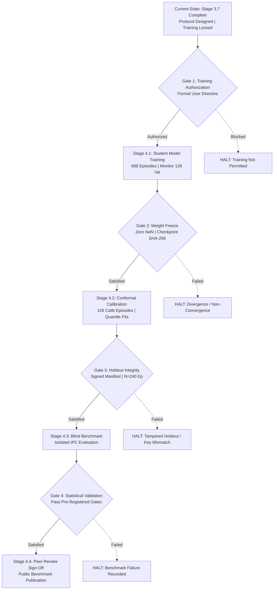

# HOROS PROBE-1 — Research-002
## Stage 3.7 Deliverable 07: Stage 4 Progression Gate Matrix

**Program:** HOROS Physical Interaction Data Engine (PIDE)  
**Research Program:** PROBE-1 — Autonomous Robotic Manipulation World Model  
**Stage:** Stage 3.7 — Independent Blind Evaluation Protocol Design  
**Document Identifier:** `HOROS-P1-R002-STAGE37-GAT-07-STAGE4-GATES`  
**Date:** 2026-11-25  
**Governance State:** `TRAINING_PERMITTED = 0` | `EXECUTION_AUTHORIZED = 0` | `NEW_HOLDOUT_GENERATION = NOT_AUTHORIZED` | `FINAL_HOLDOUT_EVALUATION = BLOCKED`  
**Security Classification:** FORMAL PROGRESSION GATES & DECISION CRITERIA  

---

### 1. Overview & Progression Architecture

Progression from Stage 3.7 into and through Stage 4 is strictly governed by a sequential, fail-closed gate matrix. No stage or operational phase may commence until its governing gate has been satisfied with reproducible cryptographic and statistical evidence.

---

### 2. Comprehensive Stage 4 Progression Gate Matrix

| Gate ID & Name | Governing Phase | Primary Verification Criteria | Mathematical Threshold or Cryptographic Target | Blocking Prerequisite for Progression |
| :--- | :--- | :--- | :--- | :--- |
| **Gate 4.1: Training Authorization** | Pre-Stage 4.1 | Formal user authorization token enabling training in workspace environment. | `TRAINING_PERMITTED = 1` `EXECUTION_AUTHORIZED = 1` | User command explicitly unlocking training. |
| **Gate 4.2: Convergence & Numerical Health** | Stage 4.1 End | Training completes all epochs without loss spikes, gradient explosion, or numerical anomalies. | Total $\text{NaN} = 0$, $\text{Inf} = 0$. Validation loss monotonicity over last 5 epochs. | Successful completion of training loop. |
| **Gate 4.3: Checkpoint Freeze & Pinning** | Pre-Stage 4.2 | Model parameters exported to read-only checkpoint, SHA-256 calculated and committed to version control. | Deterministic Checkpoint Hash: `SHA256(weights.pt)` pinned in Git commit. | Checkpoint exported and hashed. |
| **Gate 4.4: Conformal Calibration** | Stage 4.2 End | Mode-conditional nonconformity scores computed on 126 calibration episodes. | Empirical Marginal Coverage: $\ge 90.0\%$ at nominal $1 - \alpha = 0.90$. | Calibration score ledger verified. |
| **Gate 4.5: Private Holdout Authentication** | Pre-Stage 4.3 | Replacement blind holdout ($N = 240$) verified via Ed25519 digital signature and streaming SHA-256 table. | Ed25519 Signature Verified. Archive digest match: $240 / 240$ ($100\%$). Zero compromised seeds. | Dataset Custodian signed release. |
| **Gate 4.6: Multi-Horizon Accuracy** | Stage 4.3 End | HCTT-256 multi-horizon state and wrench prediction MSE vs strongest frozen baseline ($B3$). | $\ge 40.0\%$ MSE reduction over B3 at $H = 5$ and $H = 20$. | Benchmark evaluation execution. |
| **Gate 4.7: Contact Mode Discrimination** | Stage 4.3 End | Macro-F1 across operational contact modes (0..4). | Primary Gate: $\ge \mathbf{0.800}$ *(Stretch Target: $\ge 0.850$)*. | Mode confusion matrix evaluated. |
| **Gate 4.8: Physical Identifiability** | Stage 4.3 End | Latent representation $R^2$ for friction ($\mu$) and dynamic mass ($m_{\text{obj}}$). | Friction $\mu$: $R^2 \ge \mathbf{0.600}$. Mass: $R^2 \ge \mathbf{0.600}$ on dynamic segments ($|\ddot{x}| > 0.05\text{ m/s}^2$). | System-ID regression evaluated. |
| **Gate 4.9: OOD Robustness** | Stage 4.3 End | Discrimination AUROC between stationary nominal vs nonstationary friction collapse strata. | $\text{AUROC} \ge \mathbf{0.850}$. | Residual distribution evaluated. |
| **Gate 4.10: Final Scientific Sign-Off** | Stage 4.4 End | Comprehensive peer-reviewable report signed off with zero evaluation data leakage. | Immutable audit trail logged. One-time holdout marked `CONSUMED`. | Research director formal approval. |

---

### 3. Threshold Disposition & Human Sign-Off Register

| Gate Threshold | Draft Setting | Scientific Assessment | Formal Status | Action Required Prior to Stage 4.3 |
| :--- | :---: | :--- | :---: | :--- |
| **Multi-Horizon MSE Reduction** | $\ge 40\%$ | Strong physical grounding due to causal RoPE history ($H_{\text{hist}} = 10$). | **CONFIRMED** | Locked in evaluation runner. |
| **Contact Mode Macro-F1** | $\ge 0.850$ | Baseline B3 achieved $0.620$. Reaching $0.850$ requires near-flawless detection of transient FirstContact (Mode 1). Recommended dual-gate: $0.800$ required, $0.850$ stretch. | **FLAGGED** | **Requires human approval** to adopt dual-gate formulation ($0.800$ / $0.850$). |
| **Latent Mass $R^2$** | $\ge 0.600$ | Mass is physically unobservable during stationary dwells ($\ddot{x} \approx 0$). Recommending segment conditioning ($|\ddot{x}| > 0.05\text{ m/s}^2$). | **FLAGGED** | **Requires human approval** to apply acceleration conditioning to mass $R^2$. |
| **OOD AUROC** | $\ge 0.850$ | Large predictive residuals on friction collapse make this highly achievable. | **CONFIRMED** | Locked in evaluation runner. |
| **Conformal Coverage** | $\ge 90.0\%$ | Theoretically guaranteed under exchangeability on calibration split. | **CONFIRMED** | Locked in evaluation runner. |

---

### 4. Stage 3.7A Addendum: Hardened Gate Decision Rules & Safety Mode Separation

1. **Lower Confidence Bound (LCB) Pass Criteria:**
   - Formal gate passage is evaluated on the **$95\%$ Lower Confidence Bound** computed via $B = 10,000$ stratified cluster bootstrap resamples at the episode level.
   - Point estimates alone are insufficient to pass gates: $\text{LCB}_{95\%}(\text{MSE Reduction}) \ge 40.0\%$, $\text{LCB}_{95\%}(\text{Macro-F1}) \ge 0.800$.
2. **Gate 4.7A (Jamming & Release Safety Gates):**
   - Contact Mode 5 (Jamming) and Mode 6 (Release) are separated from the primary 5-mode Macro-F1 metric.
   - If present in the evaluated holdout strata:
     - Jamming Detection Recall: $\ge 0.750$.
     - False Release Rate: $\le 0.050$.
   - If absent ($N=0$): reported transparently as `UNTESTED_SAFETY_MODE`.
3. **Hardened Gate 4.5 (Cryptographic Release Authentication):**
   - Private holdout manifest must be verified via asymmetric **Ed25519** digital signature against pinned public key.
   - Release reservation must be logged atomically in `DurableHoldoutLock` before private data decryption begins.

---

### 5. Stage 3.7B Addendum: Production Integration & OS Isolation Enforcement

1. **Gate 4.5B (Integrated Manifest & Ledger Verification):**
   - The evaluator executes `verify_signed_evaluation_manifest` against independently registered public keys in `_TRUSTED_EVALUATION_PUBLIC_KEYS`.
   - Missing or tampered production ledgers raise `LedgerMissingError` or `LedgerCorruptedError` and block evaluation.
2. **Gate 4.5C (Burn-on-Access State Machine):**
   - The release transitions through `RESERVED` -> `DATA_ACCESS_AUTHORIZED` -> `DATA_ACCESSED` -> `CONSUMED`.
   - Once data access begins, the release is permanently burned; any interruption or crash transitions state to `ABORTED` with `private_data_accessed=True`.
3. **Gate 4.5D (Windows OS Worker Isolation):**
   - The inference worker is spawned under OS-level isolation with stripped environment variables and network blackholing (`HTTP_PROXY=0.0.0.0:0`).
   - Private holdout vault access is blocked by Windows NTFS Deny ACLs (`icacls /deny <user>:(OI)(CI)(RD)`).
   - Bi-directional schema validation enforces strict model inputs (`states`, `actions`, `wrenches`, `task`) and prevents privileged leakage.

